<div style="text-align:center; margin-top:2cm;">

# Evaluación 2 — Proyecto Integrado

### Mantenedor de Calificaciones Tributarias (FactorUno)

</div>

<div style="margin:3cm 60px 0; line-height:2;">

| | |
|---|---|
| **Institución:** | INACAP |
| **Sede:** | Talca |
| **Carrera / Programa:** | Informática |
| **Asignatura:** | Proyecto Integrado (TIHI43) |
| **Profesor:** | Christian Pérez |
| **Sección / Grupo:** | t420 |
| **Integrantes:** | Benjamín Cifuentes Vergara |
| **Empresa solicitante:** | nuam |
| **Proyecto:** | Mantenedor de Calificaciones Tributarias (FactorUno) |
| **Repositorio:** | https://github.com/Gatoco/FactorUno |
| **Fecha de entrega:** | Viernes 16 de octubre de 2026 |

</div>

## Introducción

Este documento es la **Evaluación 2 (sumativa)** del ramo Proyecto Integrado y continúa el trabajo presentado en la Evaluación 1. Siguiendo la indicación del profesor, el informe se estructura con **la rúbrica como índice**: cada criterio de evaluación es un título de sección, con predominio de gráficos, esquemas y tablas.

El proyecto es el **Mantenedor de Calificaciones Tributarias (FactorUno)** solicitado por **nuam**: una aplicación web que consolida las calificaciones tributarias de los corredores, calcula factores a partir de los montos de dividendos y mantiene trazabilidad completa de las operaciones.

Respecto de la Evaluación 1, esta entrega incorpora: **autenticación y autorización con roles** (2.1.5.10), **análisis de amenazas y mitigación** (2.1.5.11), **estándares de codificación segura aplicados** (2.1.5.12), una **suite de 98 pruebas automatizadas** unitarias, integrales y de rendimiento con 96% de cobertura (2.1.6.13–2.1.6.14), uso de **base no estructurada** (DynamoDB y S3) además de SQLite (2.1.4.9), y el **despliegue en la nube** (AWS) verificable por el profesor. El prototipo ya era interactivo en la entrega anterior (2.1.3.5); aquí se documenta con capturas reales de la aplicación en funcionamiento.

## Índice

1. 2.1.1.1 — Actividades y fases del proyecto según metodología
2. 2.1.1.2 — Dependencias y prioridades entre tareas del cronograma
3. 2.1.2.3 — Puntos de vista del paradigma 4+1
4. 2.1.2.4 — Tecnologías y herramientas de infraestructura (justificación)
5. 2.1.3.5 — Prototipos interactivos
6. 2.1.3.6 — Consistencia visual y adaptabilidad
7. 2.1.3.7 — Retroalimentación de usuarios
8. 2.1.4.8 — Entidades y relaciones
9. 2.1.4.9 — Base de datos estructurada y no estructurada
10. 2.1.5.10 — Políticas de autenticación y autorización
11. 2.1.5.11 — Identificación de amenazas y medidas de mitigación
12. 2.1.5.12 — Estándares de codificación segura aplicados
13. 2.1.6.13 — Pruebas unitarias, integrales y de rendimiento
14. 2.1.6.14 — Uso de herramientas automatizadas y manuales

---


> **Secciones 2.1.1.1 y 2.1.1.2 de la rúbrica · Evaluación 2 (Sumativa)**
> Asignatura: Proyecto Integrado (TIHI43) · INACAP · Profesor: Christian Pérez · Grupo **t420**
> Sistema: **Mantenedor de Calificaciones Tributarias (FactorUno)** · Cliente: **nuam**
> Repositorio: https://github.com/Gatoco/FactorUno

El presente capítulo documenta la planificación del proyecto con dos propósitos: **definir las actividades y fases bajo una metodología seleccionada** (sección 2.1.1.1) y **explicitar las dependencias y prioridades** entre las tareas del cronograma (sección 2.1.1.2). Se emplean tablas y diagramas para que la planificación sea verificable de un vistazo.

---

## 2.1.1.1 — Indica actividades y fases del proyecto siguiendo una metodología seleccionada

### Metodología seleccionada: Scrum

Se mantiene la metodología **Scrum**, ya seleccionada y justificada en la **Evaluación 1** (sección *"Selección de la metodología de desarrollo"*), donde se eligió por sobre Cascada y Kanban. Es coherente con este proyecto porque:

- los requisitos son **definidos pero evolutivos** (el cliente entregó Historias de Usuario en el archivo `HDU_Inacap.xlsx`);
- **nuam es un cliente presente y colaborativo**, con el que se validan los incrementos;
- el alcance se entrega por **incrementos funcionales** dentro del período anual de calificaciones;
- se alinea con la cultura del cliente, que declara trabajar con "metodologías ágiles orientadas al cliente y a la innovación".

Scrum organiza el trabajo en **sprints** (iteraciones cortas), con un **Product Backlog** priorizado, reuniones de planificación, revisiones con el cliente y una retrospectiva al cierre de cada iteración.

### Roles, artefactos y eventos de Scrum aplicados

| Elemento Scrum | Rol en el proyecto |
|---|---|
| **Product Owner** | nuam (aportó el HDU y valida el alcance) |
| **Scrum Master / Líder técnico** | Benjamín Cifuentes Vergara |
| **Equipo de desarrollo** | Grupo t420 |
| **Product Backlog** | Historias de Usuario del HDU (H1–H10), priorizadas |
| **Sprint Backlog** | Tareas técnicas de cada sprint (núcleo, seguridad, pruebas) |
| **Incremento** | Versión funcional del mantenedor desplegada y verificable |
| **Sprint Planning / Review / Retrospectiva** | Al inicio y al cierre de cada sprint |

### Fases y actividades del proyecto

Las fases combinan los **eventos de Scrum** con el **ciclo técnico real** del sistema (análisis → diseño → desarrollo → seguridad → pruebas → despliegue → entrega).

| # | Fase | Actividades principales | Entregable | Plazo | Responsable |
|---|---|---|---|---|---|
| 1 | **Inicio y análisis** | Levantamiento del HDU, identificación de necesidades, priorización del Product Backlog | Product Backlog priorizado | 18-08 → 05-09-2026 | Product Owner (nuam) + equipo |
| 2 | **Diseño** | Arquitectura 4+1, modelo de datos (entidades y llaves), definición del stack | Documento de diseño | 05-09 → 17-09-2026 | Equipo t420 |
| 3 | **Sprint 1 — núcleo funcional** | Grilla con filtros (mercado, origen, período), ingreso manual de calificaciones, cálculo de factores, auditoría básica | Incremento funcional núcleo | 21-09 → 02-10-2026 | Equipo t420 |
| 4 | **Sprint 2 — carga masiva** | Carga CSV de montos y factores, actualización por llave, validaciones de negocio, log de auditoría completo | Incremento de carga masiva | 05-10 → 09-10-2026 | Equipo t420 |
| 5 | **Sprint 3 — seguridad** | Autenticación (hash + sesión), autorización por roles, codificación segura, análisis de amenazas | Módulo de seguridad | 05-10 → 12-10-2026 | Equipo t420 |
| 6 | **Sprint 4 — calidad** | Pruebas unitarias, integrales y de rendimiento; herramientas automatizadas y manuales | Resultados de pruebas | 08-10 → 14-10-2026 | Equipo t420 |
| 7 | **Datos no estructurados** | Integración de DynamoDB (auditoría) y S3 (archivos CSV / exportes) desde la aplicación | Integración de datos no estructurados | 09-10 → 14-10-2026 | Equipo t420 |
| 8 | **Despliegue** | Instancia EC2 (RHEL 9), Docker Compose, IP elástica, verificación pública | Solución en la nube | 15-10-2026 | Equipo t420 |
| 9 | **Cierre y entrega** | Informe con la rúbrica como índice, documento único con enlaces, video de demostración | Entrega Evaluación 2 | 13-10 → 16-10-2026 | Equipo t420 + usuario |

### Diagrama de fases (flujo del proyecto)

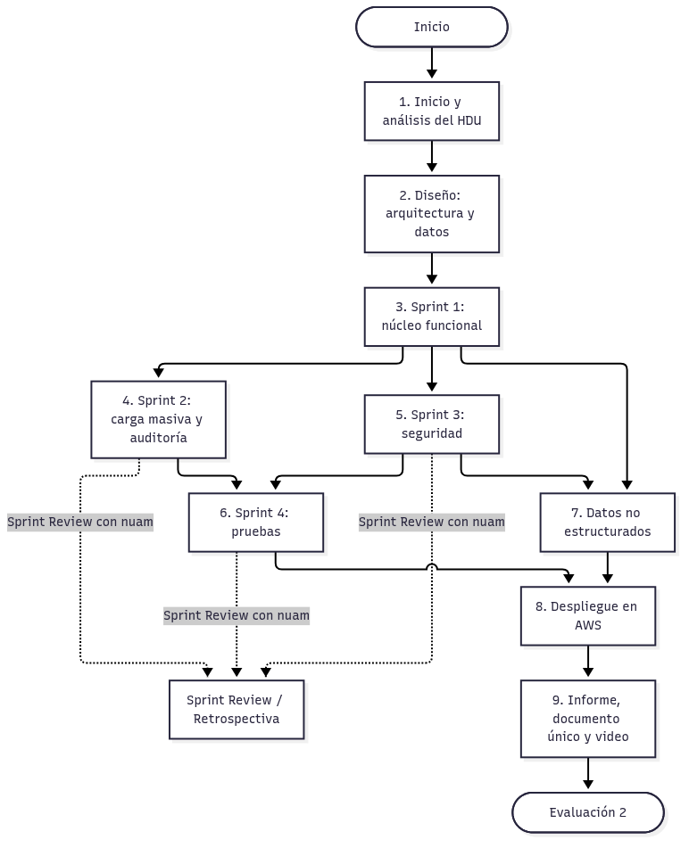

### Cronograma del proyecto (línea de tiempo)

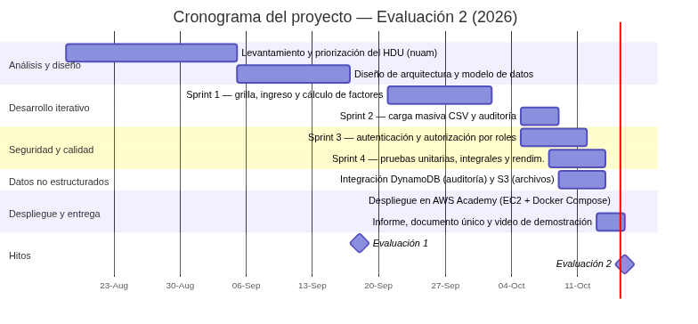

### Plazos y responsables

- **Hitos fijos (fuente: bitácora del proyecto):** Evaluación 1 el **18-09-2026**, despliegue en AWS el **15-10-2026** y entrega de la Evaluación 2 en la **semana del 12 al 18 de octubre de 2026 (viernes 16-10)**.
- **Fechas intermedias (supuesto):** las fechas de inicio y término de cada sprint corresponden al **cronograma planificado**; se derivan de los hitos fijos y de la disponibilidad del equipo.
- **Responsables (supuesto):** el desarrollo se asigna al grupo t420. Salvo Benjamín Cifuentes Vergara, la bitácora no registra los nombres de los demás integrantes, por lo que los responsables se expresan por rol.
- **Capacidad:** cada sprint mantiene plazos **alcanzables** porque reutiliza la base ya construida (el núcleo funcional existe desde antes de la Evaluación 1) y las iteraciones posteriores son incrementales sobre ese mismo código.

---

## 2.1.1.2 — Identifica dependencias y prioridades entre tareas del cronograma

### Tabla de dependencias entre actividades

Se identifican las dependencias de tipo **fin-a-comienzo (FS)**: una actividad no puede comenzar hasta que la que la precede haya terminado.

| ID | Actividad | Depende de | Precede a | Tipo | Ruta crítica |
|---|---|---|---|---|---|
| A1 | Análisis del HDU y priorización | — | A2 | — | Sí |
| A2 | Diseño de arquitectura y modelo de datos | A1 | A3 | FS | Sí |
| A3 | Núcleo funcional (grilla, ingreso, cálculo) | A2 | A4, A5, A7 | FS | Sí |
| A4 | Carga masiva CSV y auditoría | A3 | A6, A9 | FS | No |
| A5 | Seguridad (autenticación y autorización) | A3 | A6, A8, A9 | FS | Sí |
| A6 | Pruebas unitarias, integrales y de rendimiento | A4, A5 | A8 | FS | Sí |
| A7 | Datos no estructurados (DynamoDB / S3) | A3 | A9 | FS | No |
| A8 | Informe y documentación | A5, A6 | A10 | FS | Sí |
| A9 | Despliegue en AWS | A4, A5, A7 | A10 | FS | Sí |
| A10 | Entrega Evaluación 2 | A8, A9 | — | FS | Sí |

### Grafo de dependencias (ruta crítica destacada)

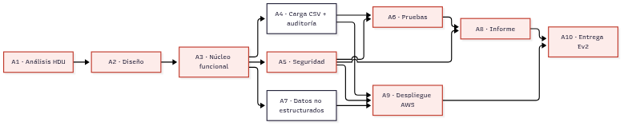

**Ruta crítica:** `A1 → A2 → A3 → A5 → A6 → A8 → A10`, con cierre en el despliegue `A9 → A10`. Cualquier retraso en el **núcleo funcional (A3)**, la **seguridad (A5)** o las **pruebas (A6)** retrasa la entrega, por lo que son las actividades que se vigilan con mayor atención. Las tareas **A4** y **A7** tienen holgura: pueden ejecutarse en paralelo sin bloquear el cierre.

### Prioridades según el marco MoSCoW

La priorización se centra en la **funcionalidad núcleo** que sostiene la demostración y en el puntaje de la rúbrica. Se aplica **MoSCoW** (Must / Should / Could / Won't).

| Prioridad | Funcionalidad | Justificación |
|---|---|---|
| **Must have** | Grilla de calificaciones con filtros (mercado, origen, período) | Es la pantalla base del sistema: sin ella no hay mantenedor que mostrar |
| **Must have** | Cálculo de factores (columnas 8–37, redondeo a 8 decimales, suma 8–19 ≤ 1) | Objetivo central del proyecto: convierte montos en factores |
| **Must have** | Carga masiva CSV con actualización por llave (upsert) | Automatiza el proceso anual y evita el ingreso manual repetitivo |
| **Must have** | Auditoría (ingreso, modificación, eliminación y carga) | Requisito de trazabilidad explícito del HDU |
| **Should have** | Autenticación y autorización por roles | Requisito de seguridad con el mayor peso de la rúbrica |
| **Should have** | Pruebas unitarias, integrales y de rendimiento | Alta ponderación en la rúbrica y respaldo de la calidad |
| **Should have** | Base no estructurada (DynamoDB / S3) | Complementa la base estructurada con historial y archivos |
| **Could have** | CRUD secundario y listados auxiliares | Útil, pero no crítico para la demostración ni para el puntaje |
| **Won't have (esta entrega)** | Módulo RAG (asistente de preguntas) e integración directa con el SII | El propio repositorio lo marca como "siguiente paso"; queda fuera del alcance |

**Criterio de priorización:** primero lo que sostiene la demostración funcional (**~80 % del sistema**, funcionalidades *Must have*); luego lo que aporta puntaje directo en la rúbrica (**seguridad y pruebas**, funcionalidades *Should have*); finalmente lo complementario (*Could have*). Las funcionalidades *Won't have* se excluyen explícitamente para no restar foco al núcleo.

---

## Fuentes y supuestos

- **Fuentes:** rúbrica oficial de Evaluación 2 (AAI); bitácora del proyecto (hitos, despliegue en AWS y estado); documento de Evaluación 1 (metodología Scrum y terminología); repositorio `Gatoco/FactorUno` (funcionalidades reales del sistema).
- **Supuestos:** las fechas intermedias de los sprints pertenecen al cronograma planificado; la composición nominal del grupo t420 (salvo Benjamín Cifuentes Vergara) no está registrada en la bitácora y se representa por rol.


> **Secciones 2.1.2.3 y 2.1.2.4 de la rúbrica · Evaluación 2 (Sumativa)**
> Asignatura: Proyecto Integrado (TIHI43) · INACAP · Profesor: Christian Pérez · Grupo **t420**
> Sistema: **Mantenedor de Calificaciones Tributarias (FactorUno)** · Cliente: **nuam**
> Repositorio: https://github.com/Gatoco/FactorUno

Este capítulo describe la arquitectura de la solución en dos partes: los **puntos de vista del paradigma 4+1 de Kruchten** (sección 2.1.2.3) y la **justificación de las tecnologías y herramientas** de la infraestructura (sección 2.1.2.4). Cada vista se acompaña de un diagrama que la resume.

La solución es una aplicación web de tres capas: una **SPA en React** (presentación), una **API REST en FastAPI** (lógica y reglas de negocio) y una **base de datos SQLite** (datos), empaquetadas y orquestadas con **Docker Compose** sobre una instancia **EC2 con RHEL 9** en AWS.

---

## 2.1.2.3 — Define los puntos de vista del paradigma 4+1 (lógica, desarrollo, procesos, físico, escenarios)

El paradigma **4+1 de Kruchten** organiza la descripción de la arquitectura en cuatro vistas de diseño —**lógica, de procesos, de desarrollo y física**— más una **vista de escenarios** que integra y valida las anteriores.

| Vista | Pregunta que responde | Elementos centrales del sistema |
|---|---|---|
| **Escenarios** | ¿Qué hace el sistema y quién lo usa? | Casos de uso del corredor, analista y administrador |
| **Lógica** | ¿Cómo se descompone en componentes? | React SPA → nginx → FastAPI → SQLite |
| **Procesos** | ¿Cómo ocurre en ejecución y concurrencia? | Flujo de una petición, uvicorn y SQLite en modo WAL |
| **Desarrollo** | ¿Cómo se organiza el código y el despliegue? | Estructura del repositorio, imágenes Docker y Compose |
| **Física** | ¿Dónde se ejecuta en la infraestructura? | EC2 t3.small (RHEL 9), Elastic IP y security group |

### Vista de escenarios (casos de uso)

Resume las funcionalidades desde la perspectiva de los actores y sirve de hilo conductor del resto de las vistas.

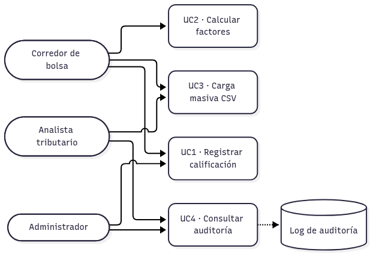

| Caso de uso | Actor principal | Descripción |
|---|---|---|
| **UC1 · Registrar calificación** | Corredor | Ingreso manual de datos básicos y 29 montos; permite modificar y eliminar |
| **UC2 · Calcular factores** | Corredor | Convierte montos en factores (columnas 8–37), redondeo a 8 decimales y suma 8–19 ≤ 1 |
| **UC3 · Carga masiva CSV** | Corredor / Analista | Carga archivos de montos o factores, con actualización por llave (upsert) |
| **UC4 · Consultar auditoría** | Analista / Administrador | Consulta el historial de ingreso, modificación, eliminación y carga |

### Vista lógica (componentes)

Describe los componentes de software y sus relaciones. La separación en capas mantiene la lógica de negocio aislada de la interfaz y del almacenamiento.

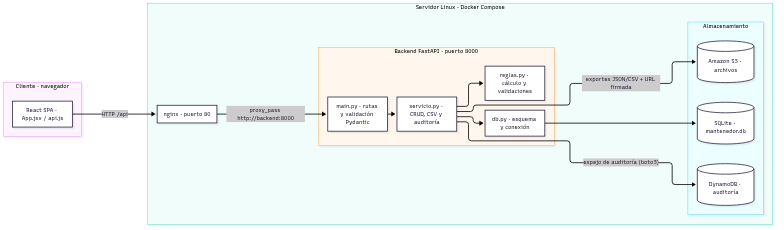

> `*` DynamoDB y Amazon S3 corresponden a la base no estructurada prevista en la Evaluación 2; la aplicación degrada de forma limpia si no están configurados.

El **backend** se organiza en cuatro módulos: `main.py` expone la API REST y valida la entrada con modelos Pydantic; `servicio.py` concentra las operaciones de negocio (listar, crear, modificar, eliminar, calcular, cargar CSV, auditar); `reglas.py` aplica las reglas del HDU (cálculo de factores, redondeo, validación de suma y tipo de sociedad); y `db.py` define el esquema y las conexiones. El **frontend** replica esa separación con `App.jsx` (pantalla principal), `api.js` (comunicación con el backend) y `columnas.js` (etiquetas y cálculo de la suma base).

### Vista de procesos

Describe el comportamiento en tiempo de ejecución, la concurrencia y la sincronización. La siguiente secuencia muestra el flujo de una petición típica de registro y cálculo.

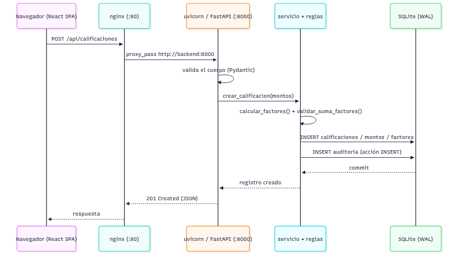

Aspectos de procesos relevantes:

- **SQLite en modo WAL** (`PRAGMA journal_mode=WAL`): permite que las lecturas no bloqueen a las escrituras, lo que favorece la consulta de la grilla y la auditoría mientras se registran datos. Las claves foráneas se activan por conexión (`PRAGMA foreign_keys=ON`), garantizando la integridad referencial entre calificaciones, montos y factores.
- **uvicorn** ejecuta la aplicación FastAPI atendiendo cada petición HTTP; los puntos de entrada definidos como funciones síncronas se despachan en un pool de hilos, mientras que la carga de archivos se maneja de forma asíncrona.
- **Conexión por operación:** cada solicitud abre y cierra su conexión a SQLite, de modo que la escritura queda confirmada (commit) al finalizar y la auditoría se registra en la misma transacción que el cambio.
- **Contenedores independientes:** el frontend (nginx) y el backend (uvicorn) son procesos separados que se comunican por la red interna de Docker Compose.

### Vista de desarrollo

Muestra la organización del código y del despliegue: la estructura del repositorio, las imágenes Docker y la orquestación con Compose.

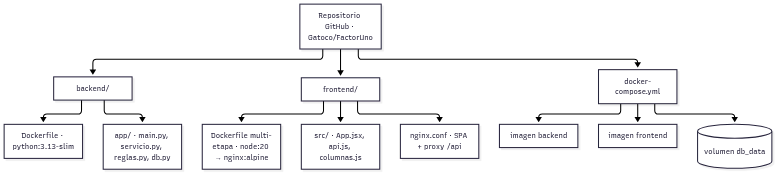

La organización es la siguiente:

- **`backend/`** contiene la aplicación FastAPI y su `Dockerfile`, que parte de `python:3.13-slim`, instala las dependencias de `requirements.txt` y arranca `uvicorn` en el puerto 8000.
- **`frontend/`** se compila con un `Dockerfile` **multi-etapa**: la primera etapa construye la SPA con Node 20 y Vite; la segunda la sirve con `nginx:alpine` y aplica `nginx.conf`, que sirve el SPA y redirige `/api/` al backend.
- **`docker-compose.yml`** orquesta los dos contenedores y declara el volumen **`db_data`**, donde persiste el archivo SQLite. En desarrollo los puertos se mapean como `5173:80` (frontend) y `8001:8000` (backend); en el servidor se exponen como `80` y `8000`.

### Vista física

Describe el despliegue sobre la infraestructura real en AWS Academy.

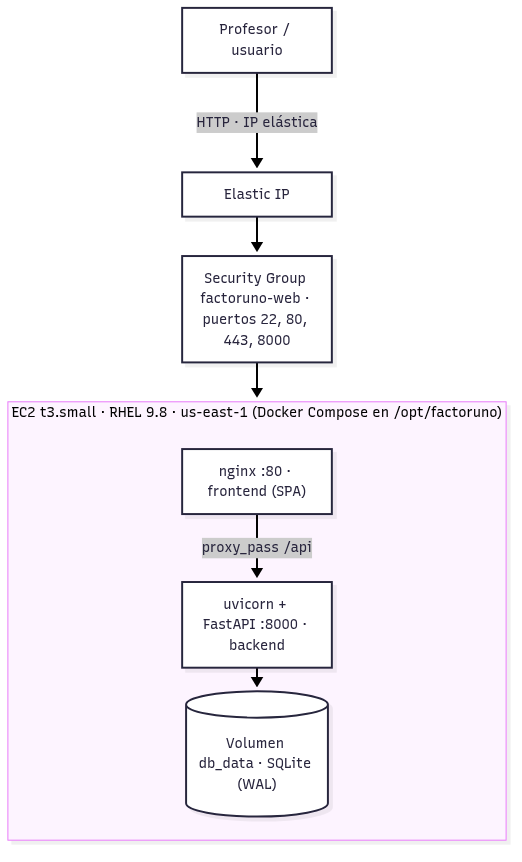

| Elemento físico | Detalle |
|---|---|
| **Instancia** | EC2 **t3.small**, sistema operativo **RHEL 9.8**, región `us-east-1` |
| **Dirección estable** | **Elastic IP** asignada a la instancia (en el despliegue de referencia, `100.56.124.163`) |
| **Security Group** | `factoruno-web`: puertos **22** (SSH), **80** (HTTP), **443** (HTTPS) y **8000** (API) |
| **Despliegue** | `docker compose up` sobre un clon del repositorio en `/opt/factoruno`, automatizado con cloud-init |
| **Persistencia** | Volumen Docker **`db_data`** con la base SQLite, independiente del ciclo de vida del contenedor |
| **Verificación en vivo del profesor** | El profesor levanta el laboratorio con la cuenta AWS del alumno, usa la **IP elástica** y revisa la solución en el navegador |

**Flujo de verificación en vivo:** el profesor inicia el AWS Academy Learner Lab con la cuenta del alumno, accede a `http://<IP elástica>` y comprueba la respuesta del frontend (HTTP 200) y de los endpoints `/api/calificaciones` y `/api/auditoria`. La **IP elástica** garantiza que la dirección no cambie entre reinicios de la instancia, de modo que la revisión es reproducible. El laboratorio es efímero (se apaga tras unas horas), por eso la entrega incluye el **correo de la cuenta AWS y la IP elástica**: con ellos el profesor puede levantar el entorno y verificar la solución en vivo.

---

## 2.1.2.4 — Especifica las tecnologías y herramientas requeridas para la infraestructura

Se detallan las tecnologías que componen la solución, su rol, las alternativas evaluadas y la justificación de cada elección.

| Tecnología | Rol en la solución | Alternativas consideradas | Justificación |
|---|---|---|---|
| **FastAPI** (Python) | API REST y reglas de negocio del backend | Flask, Django REST Framework, Node/Express | Validación estricta de entrada con Pydantic, soporte nativo para operaciones asíncronas y documentación OpenAPI automática; adecuado para reglas de negocio precisas (cálculo y redondeo) |
| **React + Vite** | SPA: grilla con filtros, formularios y carga de archivos | Vue, Svelte, HTML + JavaScript plano | React es el estándar para interfaces interactivas; Vite acelera el desarrollo (HMR) y produce un build estático optimizado que sirve nginx |
| **SQLite (modo WAL)** | Base de datos estructurada: calificaciones, montos, factores y auditoría | PostgreSQL, MySQL | No requiere servidor de base de datos aparte, persiste en un único archivo dentro del volumen y el modo WAL permite lecturas concurrentes; suficiente para el volumen anual del proceso (integridad referencial activada) |
| **Docker Compose** | Orquestación del frontend y el backend | Kubernetes, instalación manual | Empaqueta toda la aplicación y hace el despliegue **reproducible** con el mismo stack en desarrollo y en el servidor, en pocos minutos y sin dependencias manuales |
| **nginx** | Servidor de archivos estáticos y reverse proxy | Apache, Caddy | Ligero y eficiente: sirve el SPA y redirige `/api/` al backend, evitando problemas de CORS en el despliegue |
| **RHEL 9** | Sistema operativo del servidor | Ubuntu, Debian, Amazon Linux | **Recomendación explícita del profesor** (Red Hat), que además responde al contexto empresarial del cliente |
| **EC2 t3.small** | Cómputo en la nube para la aplicación | t2.micro, AWS Lambda, contenedores gestionados | Tamaño suficiente para dos contenedores y una base SQLite, con disponibilidad dentro del AWS Academy Learner Lab |
| **AWS Academy Learner Lab** | Entorno de nube provisto por la asignatura | Cuenta AWS propia, capa gratuita | Es el entorno con el que el profesor verifica la solución usando la **cuenta del alumno** y la **IP elástica** |
| **Amazon DynamoDB** | Base no estructurada para el historial de auditoría | MongoDB, Redis | Servicio gestionado y sin servidor; adecuado para el historial de eventos de auditoría |
| **Amazon S3** | Almacenamiento de CSV originales y exportes JSON | Almacenamiento en el sistema de archivos local | Almacenamiento de objetos durable y accesible, idóneo para archivos de carga y respaldos |
| **boto3** | SDK de AWS para integrar DynamoDB y S3 desde la aplicación | AWS CLI, otro SDK | Es el SDK oficial de Python, integrado en el mismo backend FastAPI |

### ¿Por qué nube?

El profesor exige que la solución esté **disponible en la nube** para que **cualquier persona pueda revisarla**. En este proyecto, la nube cumple tres propósitos concretos:

1. **Revisión en vivo por parte del profesor.** La entrega incluye el **correo de la cuenta AWS y la IP elástica**; con ellos el profesor levanta el AWS Academy Learner Lab y verifica la solución funcionando en tiempo real, sin depender de una demostración local.
2. **Dirección estable y reproducible.** La **Elastic IP** fija la dirección de la aplicación, de modo que la revisión no se rompe entre reinicios de la instancia, y el despliegue con **Docker Compose** puede repetirse en minutos.
3. **Contexto realista del negocio.** El proceso anual de calificaciones requiere que los corredores accedan al mantenedor desde cualquier lugar durante el período de alta demanda; la nube aporta esa **disponibilidad** y la posibilidad de **escalar** el servidor según la carga.

---

## Fuentes y supuestos

- **Fuentes:** rúbrica oficial de Evaluación 2 (AAI); bitácora del proyecto (datos de despliegue: EC2 t3.small, RHEL 9.8, Elastic IP, security group 22/80/443/8000 y verificación pública); repositorio `Gatoco/FactorUno` (`README.md`, `docker-compose.yml`, `backend/app/*`, `frontend/*`).
- **Supuestos:** los puertos de despliegue (`80` y `8000`) se ajustan respecto de los valores de desarrollo (`5173:80` y `8001:8000`) del `docker-compose.yml` del repositorio. Las integraciones DynamoDB y S3 están implementadas en `backend/app/aws_ext.py` y se activan por variables de entorno al desplegar en la nube; sin ellas la aplicación opera solo con SQLite.


## 2.1.3.5 Prototipos interactivos

El prototipo de la solución evolucionó hasta convertirse en una **aplicación web completamente funcional e interactiva** (no solo pantallas estáticas): el mantenedor FactorUno permite navegar, filtrar, ingresar datos, calcular factores y auditar operaciones en tiempo real. Esto supera el nivel de un prototipo de baja fidelidad y se alinea directamente con el requisito del profesor de demostrar la funcionalidad del sistema en vivo.

El prototipo se construyó con la misma tecnología del producto final (**React + Vite** en el frontend, **FastAPI** en el backend), por lo que cada iteración fue directamente reutilizable. El flujo principal implementado es:

1. **Inicio de sesión** con usuario y contraseña (roles `admin`, `analista`, `consulta`).
2. **Grilla de calificaciones** con filtros por mercado, origen y período.
3. **Detalle de un registro** con sus montos y factores calculados.
4. **Ingreso manual** de una calificación (datos básicos + 29 montos).
5. **Carga masiva** por archivo CSV.
6. **Cálculo automático** de factores con redondeo a 8 decimales.
7. **Auditoría** de todas las operaciones (creación, modificación, eliminación, cálculo y carga).

Las siguientes capturas corresponden a la aplicación ejecutándose:

| Nº | Pantalla | Descripción |
|----|----------|-------------|
| 1 | Inicio de sesión | Autenticación con rol; bloquea el acceso al sistema sin credenciales. |
| 2 | Grilla principal | Listado de calificaciones con filtros por mercado, origen y período. |
| 3 | Detalle del registro | Montos por columna y factores calculados (8 decimales, suma ≤ 1). |
| 4 | Auditoría | Historial de operaciones con usuario, acción, registro y fecha. |
| 5 | Ingreso manual | Formulario de datos básicos del certificado. |
| 6 | Montos | Pestaña de los 29 montos por columna (8–36). |
| 7 | Vista móvil | Adaptabilidad en pantalla de teléfono (390 × 844). |


## 2.1.3.6 Consistencia visual y adaptabilidad

La interfaz aplica un **sistema de diseño único** en todas las vistas, lo que garantiza consistencia visual:

- **Tipografía**: una sola familia tipográfica con jerarquías claras (título, subtítulo, cuerpo, dato).
- **Paleta**: un color primario para acciones, gris neutro para fondos y estructura, rojo solo para acciones destructivas (eliminar), verde/neutro para estados.
- **Componentes reutilizables**: botones, tarjetas, modales (detalle, ingreso, montos), tablas y pestañas mantienen el mismo aspecto y comportamiento en toda la aplicación.
- **Retroalimentación**: mensajes de error del backend se muestran al usuario sin ambigüedad (por ejemplo, al intentar ingresar sin sesión o al enviar datos inválidos).

La **adaptabilidad** está resuelta con una hoja de estilos responsiva: la barra de navegación, la grilla y los formularios se reordenan y apilan en pantallas pequeñas. La captura 7 demuestra la aplicación renderizada en un viewport móvil (390 × 844 px), manteniendo legibilidad y operabilidad de las acciones principales.

| Aspecto | Criterio aplicado | Evidencia |
|---------|-------------------|-----------|
| Consistencia tipográfica | Jerarquías únicas en todas las vistas | Capturas 1–6 |
| Consistencia de color | Paleta única, rojo solo para acciones destructivas | Capturas 2, 3, 6 |
| Consistencia de componentes | Modales, tablas y botones homogéneos | Capturas 3, 5, 6 |
| Adaptabilidad | Layout responsivo usable en móvil | Captura 7 |


## 2.1.3.7 Retroalimentación de usuarios

> **Nota de alcance.** Esta sección describe el mecanismo de retroalimentación adoptado por el equipo y aplica los hallazgos ya incorporados durante el desarrollo (iteraciones internas y ajustes derivados del material del cliente). Los instrumentos de validación con usuarios del proceso (checklist heurístico y encuesta breve) quedan definidos en esta sección y **sus resultados se anexan al cierre de la entrega**.

La retroalimentación se gestionó en dos ciclos:

1. **Durante el desarrollo (aplicada).** Cada demostración interna del flujo principal (grilla → detalle → cálculo) generó ajustes concretos incorporados al prototipo:
   - el detalle pasó de una pantalla aparte a un **modal en contexto** sobre la grilla, reduciendo clics para revisar factores;
   - el ingreso de montos se dividió en pestañas (datos básicos / 29 montos) para evitar un formulario excesivamente largo;
   - los errores de validación del backend (suma de factores mayor a 1, formato de fecha, tipo de sociedad inválido) se muestran junto al campo correspondiente o en el modal, en vez de fallar silenciosamente;
   - se añadió el filtro por **período** tras comprobar que revisar años anteriores era una de las necesidades más frecuentes.

2. **Validación con usuarios del proceso (instrumento preparado).** Para cerrar el ciclo se definió un **checklist heurístico** (claridad de la grilla, facilidad del ingreso de montos, comprensión del resultado del cálculo, confianza en la auditoría) y una **encuesta breve** de 4 preguntas aplicable a usuarios del proceso:

| # | Pregunta | Escala |
|---|----------|--------|
| 1 | ¿La grilla y sus filtros le permiten encontrar una calificación rápidamente? | 1 (muy difícil) – 5 (muy fácil) |
| 2 | ¿El ingreso de los 29 montos le resultó claro y sin errores? | 1 – 5 |
| 3 | ¿Confía en el resultado del cálculo de factores que muestra el sistema? | 1 – 5 |
| 4 | ¿La auditoría le entrega la trazabilidad que su rol necesita? | 1 – 5 |

Los resultados de esta encuesta se incorporarán al informe final de la entrega, junto con las mejoras implementadas a partir de ellos.


## 2.1.4.8 Entidades y relaciones

El modelo de datos del mantenedor es relacional y está implementado en **SQLite**. Se compone de cinco tablas: `calificaciones` (entidad central), `montos`, `factores`, `auditoria` y `usuarios`.

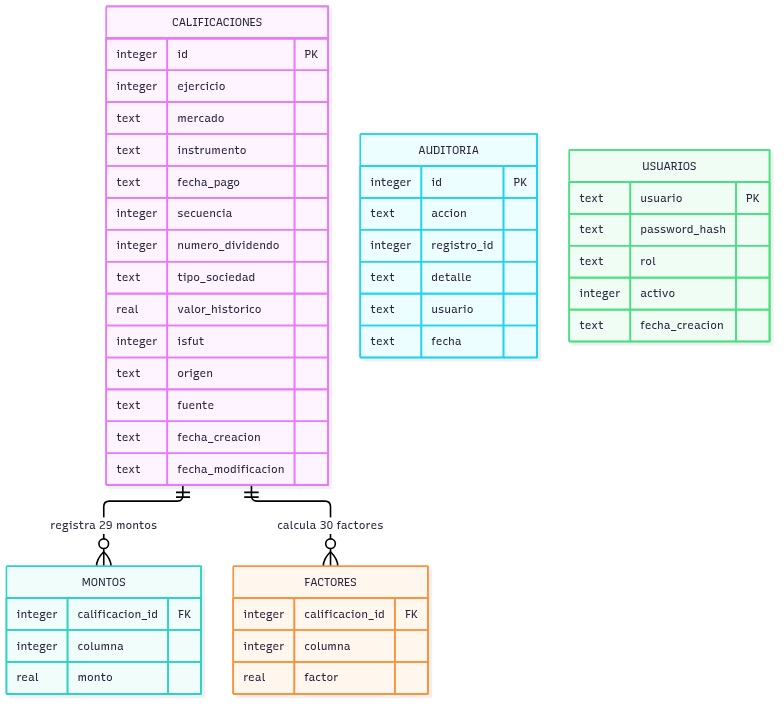

**Reglas de integridad aplicadas en la base de datos:**

| Regla | Implementación |
|-------|----------------|
| Clave primaria de negocio | Índice `UNIQUE` sobre (ejercicio, mercado, instrumento, fecha_pago, secuencia, numero_dividendo, tipo_sociedad): impide duplicar un certificado; habilita el *upsert* de la carga masiva. |
| Integridad referencial | `montos` y `factores` referencian a `calificaciones` con `FOREIGN KEY … ON DELETE CASCADE`; `PRAGMA foreign_keys=ON` en cada conexión. |
| Dominios cerrados | `CHECK` para `mercado` (1–3), `tipo_sociedad` (A/C), `origen` (corredor/entidad), `fuente` (manual/archivo/sistema) y rango de columna de montos/factores (8–37). |
| Integridad de negocio | La suma de factores de las columnas 8 a 19 no puede superar 1 (validado por la aplicación, con tolerancia de 1e-8) y los factores se redondean a 8 decimales (`ROUND_HALF_UP`). |
| Trazabilidad | Toda operación de creación, modificación, eliminación, cálculo y carga escribe un evento en `auditoria` con el usuario autenticado. |
| Concurrencia y durabilidad | SQLite en modo **WAL** (`journal_mode=WAL`), transacciones por operación. |

La entidad `usuarios` sostiene la autenticación: almacena el hash **bcrypt** de la contraseña (nunca la contraseña), el rol (`admin`, `analista`, `consulta`) y el estado activo/inactivo.

## 2.1.4.9 Base de datos estructurada y no estructurada

La solución usa **ambos tipos de almacenamiento**, integrados desde la propia aplicación:

| Almacenamiento | Tipo | Contenido | Rol en la solución |
|----------------|------|-----------|--------------------|
| **SQLite** (volumen Docker `db_data`) | Estructurada (relacional) | Calificaciones, montos, factores, usuarios y auditoría | Núcleo transaccional: toda la operatoria del mantenedor (grilla, cálculo, carga masiva) consulta y escribe aquí. |
| **Amazon DynamoDB** | No estructurada (clave-valor/documento) | Espejo del historial de auditoría | Historial de solo-anexado, desacoplado del volumen transaccional; sirve de respaldo y permite consultas externas sin tocar la base operacional. |
| **Amazon S3** | No estructurada (objetos) | Exportes JSON y CSV del mantenedor (y archivos originales que se cargan) | Evidencia descargable y respaldo de archivos; entrega URLs firmadas temporales para su descarga. |

**DynamoDB.** Cada evento de auditoría se espeja a la tabla configurada en `FACTORUNO_DYNAMO_TABLA` con la forma:

```json
{
  "id": "2026-10-15T13:05:22#CREAR#4#123456",
  "accion": "CREAR",
  "registro_id": 4,
  "detalle": "CENCOSUD S.A. 2024-03-10",
  "usuario": "analista",
  "fecha": "2026-10-15 13:05:22"
}
```

La clave `id` combina fecha, acción, registro y microsegundos para garantizar unicidad sin coordinación. El espejo es **best-effort**: si AWS no está configurado o falla, la operación principal continúa (la auditoría local en SQLite es siempre la fuente de verdad).

**Amazon S3.** El endpoint `GET /api/exportar?formato=json|csv` genera la exportación completa del mantenedor (registros con montos y factores + últimas 500 auditorías) y la sube al bucket `FACTORUNO_S3_BUCKET`, devolviendo una **URL firmada válida por 1 hora**:

| Formato | Objeto generado | Uso |
|---------|-----------------|-----|
| JSON | `factoruno-AAAAMMDD-HHMMSS.json` | Respaldo íntegro para revisión o re-importación. |
| CSV | `factoruno-AAAAMMDD-HHMMSS.csv` | Entrega tabular interoperable (Excel). |

**Degradación limpia.** Toda la integración AWS se activa por variables de entorno (`FACTORUNO_DYNAMO_TABLA`, `FACTORUNO_S3_BUCKET`, `AWS_REGION`). Sin ellas, la aplicación opera igual con SQLite y responde `503` con un mensaje claro en el endpoint de exportación; en el despliegue de la nube ambas quedan configuradas y las funciones se habilitan. Esto permite que el desarrollo y las pruebas locales no dependan de credenciales AWS.


## 2.1.5.10 Políticas de autenticación y autorización

El sistema implementa políticas **explícitas** de autenticación y autorización, aplicadas en el backend (fuente de verdad) y reflejadas en la interfaz.

### Mecanismo de autenticación

1. El usuario envía sus credenciales a `POST /api/auth/login`.
2. El backend verifica la contraseña contra el **hash bcrypt** almacenado (nunca texto plano) y que el usuario esté activo.
3. Si son válidas, emite un **token JWT firmado con HS256** (`sub`, `rol`, `iat`, `exp`), con expiración configurable por entorno (8 horas por defecto).
4. Cada petición protegida envía `Authorization: Bearer <token>`; el backend valida firma, vigencia y rol; si el token expira o es inválido responde `401` y el frontend limpia la sesión y vuelve al login.

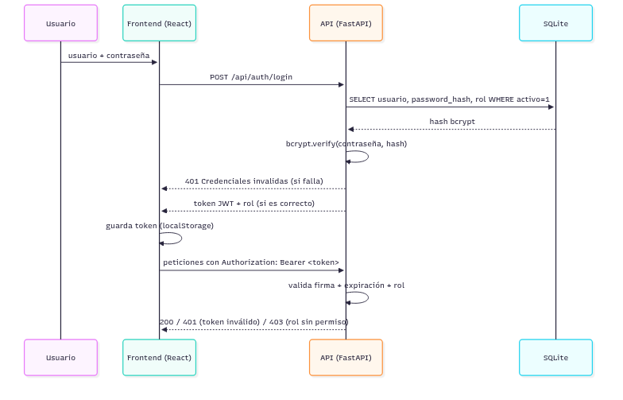

### Política de autorización: matriz de roles

Se definen tres roles con un principio de **mínimo privilegio**:

| Operación | `consulta` | `analista` | `admin` |
|-----------|:----------:|:----------:|:-------:|
| Ver grilla y detalle de calificaciones | ✅ | ✅ | ✅ |
| Crear / modificar / eliminar calificaciones | ❌ (403) | ✅ | ✅ |
| Calcular factores de un registro | ❌ (403) | ✅ | ✅ |
| Carga masiva por CSV | ❌ (403) | ✅ | ✅ |
| Ver auditoría | ❌ (403) | ✅ | ✅ |
| Exportar a S3 (JSON/CSV) | ❌ (403) | ✅ | ✅ |

- `consulta`: perfil de **solo lectura** para revisar calificaciones sin poder alterar nada (por ejemplo, un auditor externo o un usuario de consulta de la Bolsa).
- `analista`: operación diaria del corredor (ingreso, cálculo, carga masiva, auditoría).
- `admin`: mismas capacidades que `analista` más la administración de usuarios (creados por semilla/entorno; el rol no habilita operaciones destructivas adicionales sobre datos de negocio).

### Aplicación de las políticas

- **En la API:** cada endpoint protegido declara su dependencia de autenticación (`get_current_user`) y, cuando corresponde, de rol (`requiere_rol("admin","analista")`). Sin token válido la respuesta es `401`; con token de rol insuficiente, `403`. La suite de pruebas verifica la matriz completa (16 pruebas dedicadas).
- **En la interfaz:** la UI oculta o deshabilita las acciones según el rol (pestaña Auditoría, botones Ingresar, Carga CSV, Modificar, Eliminar, Calcular). Se documenta explícitamente que **la UI no es un control de seguridad**: aunque se manipule el cliente, la API rechaza cualquier operación no autorizada.
- **Trazabilidad:** cada operación registra en la auditoría el **usuario autenticado real** que la ejecutó (no un valor fijo), de modo que la matriz de roles es verificable sobre los hechos.
- **Gestión de secretos:** el secreto JWT y las contraseñas semilla se inyectan por variables de entorno (`.env.example` documenta las claves; `.env` no se versiona). En producción se define un secreto fuerte al desplegar.

### Alineación con buenas prácticas

| Práctica (OWASP ASVS / Top 10) | Aplicación en FactorUno |
|--------------------------------|--------------------------|
| Hash robusto de credenciales | bcrypt con salt por usuario. |
| Sesiones con expiración | JWT con `exp` (8 h) y validación en cada petición. |
| Control de acceso centralizado | Dependencias FastAPI por endpoint; matriz único en `auth.py`. |
| Mínimo privilegio | Tres roles; `consulta` sin escritura ni auditoría. |
| No filtrar información | `401`/`403` genéricos; errores de validación acotados. |
| Registro de auditoría | Cada acción con usuario, fecha y detalle. |

**Limitación declarada:** no se implementó limitación de tasa (rate limiting) en el login; se mitiga parcialmente con la latencia de bcrypt y la auditoría de accesos fallidos. Queda identificado como riesgo residual en el análisis de amenazas (sección 2.1.5.11) y como trabajo futuro.


## 2.1.5.11 Identificación de amenazas y medidas de mitigación

> Análisis de amenazas del Mantenedor de Calificaciones Tributarias (FactorUno)
> aplicando la metodología **STRIDE** sobre la arquitectura desplegada en AWS.
> Fecha: octubre de 2026. Autores: grupo t420.

### 1. Alcance y activos

| Activo | Descripción | Exposición |
|---|---|---|
| Datos tributarios | Calificaciones, montos (columnas 8–19) y factores (8–37) de instrumentos financieros | API pública vía Elastic IP |
| Credenciales de usuario | Usuarios `admin`, `analista`, `consulta` con contraseña hasheada | Formulario de login |
| Tokens de sesión | JWT firmados (HS256, expiración 8 h) | Almacenados en el navegador (localStorage) |
| Registro de auditoría | Trazabilidad de INSERT/UPDATE/DELETE/CALCULAR/CARGA con usuario real | Solo roles admin/analista |
| Infraestructura | EC2 t3.small (RHEL 9), contenedores Docker, nginx, SQLite (WAL) | Security Group 22/80/443/8000 |

### 2. Arquitectura y límites de confianza

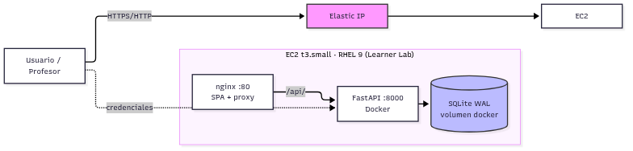

Límites de confianza: (1) Internet ↔ Elastic IP, (2) nginx ↔ backend, (3) backend ↔ base de datos, (4) usuario ↔ API de autenticación.

### 3. Análisis STRIDE

#### S — Spoofing (suplantación de identidad)

| Amenaza | Vector | Mitigación implementada |
|---|---|---|
| Suplantar a un usuario con credenciales robadas | Fuerza bruta o filtración | Contraseñas con hash **bcrypt** (nunca en texto plano); token JWT firmado HS256 con expiración configurable (`FACTORUNO_TOKEN_HORAS`, por defecto 8 h) |
| Falsificar un token | Manipular el JWT en el navegador | Firma verificada en cada petición; token inválido → **401** (`app/auth.py:get_current_user`) |

Limitación conocida: no hay *rate limiting* en el login (ver §5).

#### T — Tampering (manipulación de datos)

| Amenaza | Vector | Mitigación implementada |
|---|---|---|
| Modificar montos/factores sin autorización | Petición directa a la API | Todos los endpoints de escritura exigen rol **admin/analista** (`Depends(auth.requiere_rol(...))`) |
| Inyección SQL | Payloads en filtros o campos | Consultas **parametrizadas** en todo `servicio.py`; el `UPDATE` dinámico usa una *whitelist* fija de columnas |
| CSV malicioso (fórmulas, tipos inválidos) | Carga masiva | Validación campo a campo con Pydantic + `reglas.py`; filas inválidas se rechazan individualmente y se reportan en `errores[]` |
| Alterar la regla de negocio (suma de factores ≤ 1) | Enviar factores manuales | `validar_suma_factores` se ejecuta en crear, modificar, calcular y cargar (umbral 1,00000001) |

#### R — Repudiation (repudio)

| Amenaza | Vector | Mitigación implementada |
|---|---|---|
| Negar haber modificado un registro | Falta de trazabilidad | Tabla `auditoria`: cada INSERT/UPDATE/DELETE/CALCULAR/CARGA registra **usuario autenticado real**, acción, registro y fecha (`db.py:audit`) |
| Ocultar el origen de una carga masiva | Carga por archivo | Cada fila cargada genera evento CARGA con número de fila |

#### I — Information Disclosure (divulgación de información)

| Amenaza | Vector | Mitigación implementada |
|---|---|---|
| Leer datos sin autenticarse | Acceso anónimo | **Todos** los endpoints `/api/*` (excepto login) exigen token; sin token → 401 |
| Robo de datos por XSS | Scripts inyectados en la SPA | CSP `default-src 'self'`, `script-src 'self'`; React escapa la salida por defecto |
| Fuga de detalles técnicos | Errores 500 con trazas | Errores controlados con `HTTPException` y mensajes genéricos; validación previa evita estados inconsistentes |
| CORS abierto | Orígenes arbitrarios | Lista explícita `FACTORUNO_CORS_ORIGINS` (por defecto solo `localhost:5173`) |

#### D — Denial of Service (denegación de servicio)

| Amenaza | Vector | Mitigación implementada |
|---|---|---|
| Saturación del servidor | Peticiones masivas | Instancia y lab efímeros (4 h), lo que acota la ventana de exposición; operaciones acotadas por rol |
| CSV gigantesco | Archivo de carga enorme | Validación fila a fila con reporte de errores; límite de tamaño de carga pendiente (§5) |

#### E — Elevation of Privilege (elevación de privilegios)

| Amenaza | Vector | Mitigación implementada |
|---|---|---|
| Usuario `consulta` escribiendo | Petición directa | `requiere_rol("admin","analista")` → **403**; matriz de roles verificada por tests (16 casos en `tests/test_auth.py`) |
| Escalar rol manipulando el JWT | Editar payload `rol` | El rol viaja firmado; cualquier manipulación invalida la firma → 401 |
| Acceso al contenedor o la base | Escapes de contenedor | Docker Compose con servicios aislados; SQLite solo accesible desde el backend; RHEL 9 con SELinux |

### 4. Seguridad de la infraestructura

| Control | Implementación |
|---|---|
| Segmentación de red | Security Group `factoruno-web` limitado a 22/80/443/8000 |
| Sistema operativo | **RHEL 9** (recomendación explícita del docente): SELinux, firewalld, ciclo de parches |
| Contenedores | Imágenes oficiales fijadas (`python:3.13-slim`, `node:20`, `nginx:alpine`) |
| Secretos | Variables de entorno (`FACTORUNO_SECRET`, contraseñas), nunca en el repositorio (`.env` en `.gitignore`) |
| Exposición | IP elástica dedicada; lab apagado al terminar la revisión |
| Reproducibilidad | `docker compose up` sobre clon del repositorio (`main`), despliegue repetible en ~5 min |

### 5. Riesgos residuales y trabajo futuro

| Riesgo residual | Motivo | Plan |
|---|---|---|
| Sin rate limiting en login | Dependencia no incluida | Añadir `slowapi`/tokens por IP; bcrypt ya limita la tasa efectiva |
| Sin HTTPS en el despliegue de revisión | Lab con IP directa | Terminar TLS en nginx (Let's Encrypt o certificado autofirmado) |
| Sin límite de tamaño de subida | Simplificación | Límite de N MB en `POST /api/carga` y en nginx (`client_max_body_size`) |
| Token en localStorage | Simplicidad SPA | Migrar a cookie httpOnly + CSRF token |
| Sin monitoreo/alertas | Alcance académico | CloudWatch básico en un despliegue productivo |

### 6. Trazabilidad amenaza → control → evidencia

| Amenaza | Control | Evidencia |
|---|---|---|
| Suplantación | bcrypt + JWT | `app/auth.py`; `tests/test_auth.py::test_login_con_password_incorrecta_retorna_401` |
| Escritura sin permiso | Matriz de roles | `tests/test_auth.py::test_consulta_no_puede_crear` (403) |
| Inyección SQL | Consultas parametrizadas | `app/servicio.py` (sin concatenación de valores) |
| CSV inválido | Validación por fila | `tests/test_servicio.py::test_carga_csv_reporta_filas_invalidas` |
| Repudio | Auditoría con usuario real | `tests/test_servicio.py::test_auditoria_registra_insert_update_delete` |
| Fuga de información | Headers + CSP + CORS | `frontend/nginx.conf`, `app/main.py` |


## 2.1.5.12 Estándares de codificación segura aplicados

> Prácticas de codificación segura aplicadas en el código de FactorUno,
> alineadas al **OWASP Top 10 (2021)** y a controles de validación,
> autenticación, manejo de errores y gestión de secretos.
> Fecha: octubre de 2026. Autores: grupo t420.

### 1. Estándares adoptados

| Estándar | Aplicación en el proyecto |
|---|---|
| OWASP Top 10 (2021) | Checklist principal (tabla §2) |
| OWASP ASVS (referencia) | Validación de entrada, sesión y control de acceso |
| PEP 8 + type hints | Estilo y anotaciones (`str \| None`, `dict[int, float]`) en todo `backend/app` |
| Conventional Commits | Historial de cambios auditable en Git |
| Principio de mínimo privilegio | Roles admin/analista/consulta; contenedores sin puertos innecesarios |

### 2. OWASP Top 10 → Implementación

| Riesgo | Aplicación en FactorUno | Dónde |
|---|---|---|
| A01 Control de acceso roto | Guards por rol en cada endpoint; `consulta` solo lectura | `app/main.py` (`Depends(auth.requiere_rol(...))`), `tests/test_auth.py` |
| A02 Fallas criptográficas | bcrypt para contraseñas; JWT HS256 firmado con secreto de entorno | `app/auth.py` |
| A03 Inyección | SQL parametrizado; whitelist de columnas en UPDATE; validación Pydantic | `app/servicio.py:101-107`, modelos en `app/main.py` |
| A04 Diseño inseguro | Análisis STRIDE documentado; reglas de negocio validadas en servidor | `docs/seguridad/01-amenazas-y-mitigacion.md`, `app/reglas.py` |
| A05 Mala configuración | Sin `*` en CORS; headers de seguridad en nginx; secretos por entorno | `app/main.py:_cors_origins`, `frontend/nginx.conf`, `.env.example` |
| A06 Componentes vulnerables | Dependencias fijadas con versión mínima; imágenes oficiales mínimas | `backend/requirements.txt`, Dockerfiles |
| A07 Fallas de autenticación | Hash + verificación; token con expiración; 401 uniforme | `app/auth.py:autenticar`, `test_auth.py` |
| A08 Integridad | Repositorio Git con commits convencionales; imágenes reproducibles | historial del repositorio |
| A09 Registro insuficiente | Auditoría de todas las mutaciones con usuario real | `app/db.py:audit`, `tests/test_servicio.py` |
| A10 SSRF | No se consumen URLs externas; alcance mínimo | — |

### 3. Prácticas aplicadas en el backend

1. **Validación en el borde**: cada modelo Pydantic restringe tipos y rangos (`ejercicio` 2000–2100, `tipo_sociedad` `^[AaCc]$`, `origen` `corredor|entidad`), de modo que la API rechaza entradas malformadas antes de tocar la lógica.
2. **Consultas parametrizadas**: nunca se concatenan valores del usuario en SQL; el único fragmento dinámico (nombres de columna en `UPDATE`) proviene de una whitelist fija del código.
3. **Reglas de negocio en el servidor**: el cálculo de factores, el redondeo a 8 decimales y la validación `suma 8..19 ≤ 1` viven en `reglas.py` y se ejecutan siempre, aunque el cliente las omita.
4. **Contraseñas**: hash con bcrypt (salt por usuario); comparación en tiempo constante vía librería; nunca se registran en logs ni se devuelven.
5. **Tokens**: JWT firmado (HS256) con `sub`, `rol`, `iat`, `exp`; secreto y horas de validez configurables por entorno.
6. **Errores controlados**: `HTTPException` con mensajes genéricos ("Credenciales invalidas", "Calificacion no encontrada"); no se exponen trazas al cliente.
7. **Auditoría**: cada mutación registra acción, registro, detalle, usuario autenticado y fecha.
8. **Secretos fuera del código**: `FACTORUNO_SECRET` y contraseñas iniciales se leen de variables de entorno; `.env.example` documenta las claves y `.env` está ignorado por Git. El despliegue escribe un secreto propio del servidor.

### 4. Prácticas aplicadas en el frontend

- **CSP estricta**: `default-src 'self'`, `script-src 'self'` (sin inline), `frame-ancestors 'none'` — mitiga XSS.
- **Headers de defensa**: `X-Content-Type-Options: nosniff`, `X-Frame-Options: DENY`, `Referrer-Policy: no-referrer`, `Permissions-Policy` sin cámara/micrófono/geolocalización.
- **Sesión**: el token se adjunta como `Authorization: Bearer` en cada petición; ante 401 se limpia la sesión y se vuelve al login.
- **El gate de UI por rol no es un control de seguridad**: es solo usabilidad; el servidor rechaza igualmente cualquier operación no autorizada.

### 5. Flujo seguro de una petición

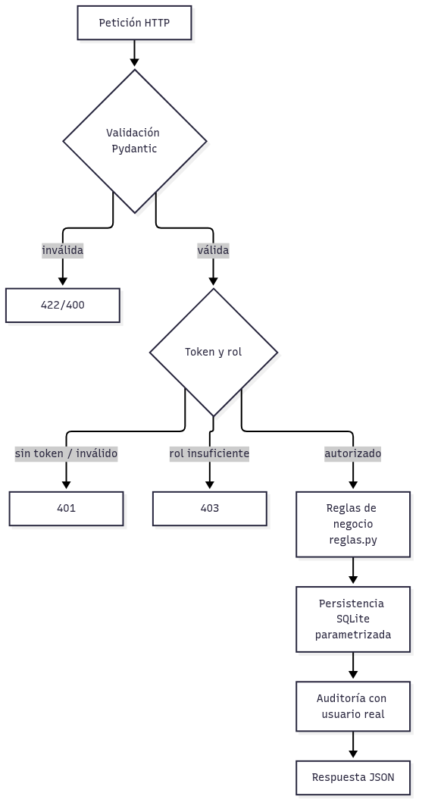

### 6. Verificación y evidencia

| Control | Comando / evidencia |
|---|---|
| Suite completa | `cd backend && .venv/bin/python -m pytest tests/ -q` → **90 passed** |
| Cobertura | `--cov=app` → **96 %** (reglas 100 %, auth 94 %, servicio 96 %) |
| Casos de seguridad | 16 pruebas de autenticación/autorización (401/403/roles) |
| Integridad de carga | Carga CSV idempotente por llave de negocio probada (`test_carga_csv_inserta_y_es_idempotente_por_llave`) |
| Auditoría | Usuario real registrado en cada evento (`test_auditoria_registra_insert_update_delete`) |

### 7. Checklist de revisión de código (aplicada en cada cambio)

- [ ] ¿La entrada pasa por un modelo Pydantic o validación explícita?
- [ ] ¿El SQL usa parámetros y, si es dinámico, whitelist?
- [ ] ¿El endpoint declara el rol mínimo necesario?
- [ ] ¿La mutación deja evento de auditoría con el usuario real?
- [ ] ¿Los errores devuelven mensajes genéricos sin trazas?
- [ ] ¿Hay secretos nuevos? ¿Van por entorno y quedan fuera de Git?
- [ ] ¿La regla de negocio (factores ≤ 1, redondeo 8 decimales) se valida en servidor?
- [ ] ¿Se agregó o actualizó una prueba para el cambio?


## 2.1.6.13 Pruebas unitarias, integrales y de rendimiento

El plan de pruebas cubre los tres niveles solicitados por la rúbrica, con resultados ejecutados y verificables.

| Nivel | Objetivo | Alcance | Resultado |
|-------|----------|---------|-----------|
| Unitarias | Reglas de negocio puras | `app/reglas.py`: redondeo a 8 decimales, cálculo y validación de factores, normalización de fecha, tipo de sociedad, mapeo de filas CSV | **62 casos — 100% OK** |
| Integrales | API completa con autenticación y base real (SQLite temporal) | Login y matriz de roles (16), flujo CRUD completo, cálculo automático, filtros, carga CSV (idempotencia y errores por fila), auditoría, exportes S3 (8) y espejado DynamoDB | **33 casos — 100% OK** |
| Rendimiento | Tiempos sobre volumen representativo | Carga masiva CSV de **500 registros**, listado de 500 registros y cálculo de factores | **0,11 s / 0,03 s / 0,004 s** |

**Total: 98 pruebas automatizadas, 100% exitosas.**

### Resultados por archivo de prueba

| Archivo | Casos | Qué verifica |
|---------|:-----:|--------------|
| `tests/test_reglas.py` | 62 | Funciones puras de reglas de negocio (parametrizadas por caso). |
| `tests/test_auth.py` | 16 | `401` sin token / token inválido, login por rol, matriz de permisos completa, auditoría con usuario real. |
| `tests/test_servicio.py` | 9 | Flujo integral CRUD vía API, recálculo de factores, filtros, carga CSV idempotente, errores por fila, auditoría de escrituras. |
| `tests/test_aws_ext.py` | 8 | Espejo de auditoría a DynamoDB (tipos y contenido), exportes JSON/CSV a S3 (URL firmada), `503` sin bucket, `403` por rol. |
| `tests/test_perf.py` | 3 | Umbrales de tiempo de carga masiva, listado y cálculo. |

### Cobertura de código

Ejecutada con `pytest-cov` sobre `app/`:

| Módulo | Cobertura |
|--------|:---------:|
| `reglas.py` | 100% |
| `db.py` | 96% |
| `servicio.py` | 96% |
| `main.py` | 95% |
| `auth.py` | 94% |
| **Total** | **96%** |

### Rendimiento medido (pytest + `-s`)

| Escenario | Volumen | Resultado | Umbral del test |
|-----------|---------|-----------|-----------------|
| Carga masiva CSV | 500 registros | **0,11 s** | < 15 s |
| Listado con filtros | 500 registros | **0,03 s** | < 5 s |
| Cálculo de factores | 29 montos | **0,004 s** | < 2 s |

### Cómo reproducir

```bash
cd backend
.venv/bin/python -m pytest tests/ -q                          # 98 pruebas
.venv/bin/python -m pytest tests/ -q --cov=app --cov-report=term-missing
.venv/bin/python -m pytest tests/test_perf.py -s              # tiempos impresos
```

Las pruebas integrales usan **SQLite temporal** (`tmp_path`) por cada test: no tocan datos reales ni requieren credenciales AWS (las integraciones AWS se prueban con clientes simulados).

## 2.1.6.14 Uso de herramientas automatizadas y manuales

La estrategia combina herramientas **automatizadas** (regresión continua) y **manuales** (juicio funcional y de usabilidad), de forma balanceada:

### Herramientas automatizadas

| Herramienta | Uso en el proyecto |
|-------------|--------------------|
| **pytest** | Framework de pruebas: 98 casos (unitarias, integrales y rendimiento). |
| **pytest-cov** | Medición de cobertura de código (96%). |
| **httpx / TestClient** | Cliente HTTP de las pruebas integrales contra la API real (con autenticación). |
| **boto3 (mockeado)** | Verificación del espejo DynamoDB y de los exportes S3 sin consumir AWS. |
| **Script de rendimiento** | Generador de 500 registros CSV con umbrales de tiempo como aserción. |
| **Playwright (script de capturas)** | Prueba de humo E2E real sobre la interfaz: login → grilla → detalle → auditoría → modales → vista móvil (genera las capturas de la sección 2.1.3). |

### Herramientas manuales

| Actividad manual | Procedimiento | Resultado |
|------------------|---------------|-----------|
| Checklist funcional | Recorrido guiado del flujo principal en la interfaz real | Ejecutado — flujo completo OK |
| Verificación de la matriz de roles en UI | Sesión con rol `consulta` (solo lectura) vs `analista` | Ejecutado — acciones ocultas/deshabilitadas y API responde `403` |
| Revisión visual y responsiva | Revisión de consistencia y captura en viewport móvil 390×844 | Ejecutado — sin quiebres de layout |
| Revisión cruzada de errores | Envío de datos inválidos (fecha, tipo de sociedad, suma de factores > 1) | Ejecutado — mensajes claros por fila/campo |

### Justificación del balance

Lo automatizado cubre lo **determinista y repetible** (reglas, API, permisos, tiempos): es la red de seguridad que se ejecuta completa antes de cada entrega de trabajo. Lo manual cubre lo que la herramienta no juzga: **claridad visual, flujo de uso y comprensión de mensajes**, además de servir de preparación de la demostración en video. Cada hallazgo manual relevante se convirtió en un caso automatizado cuando fue posible (por ejemplo, la matriz de roles y la idempotencia de la carga CSV).
