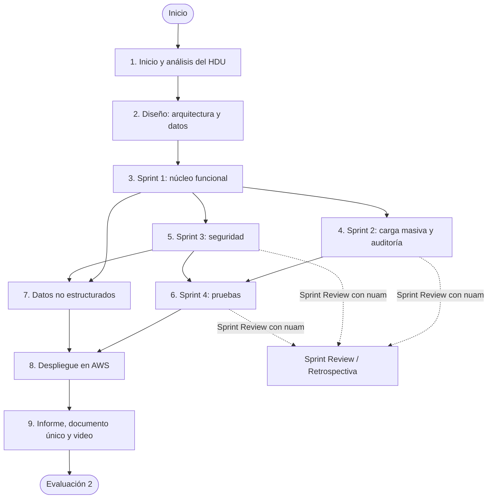
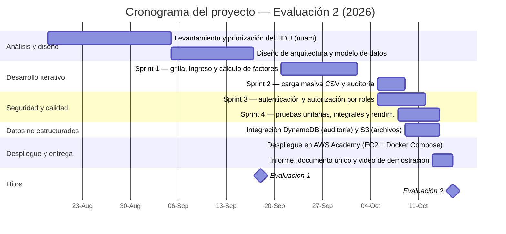
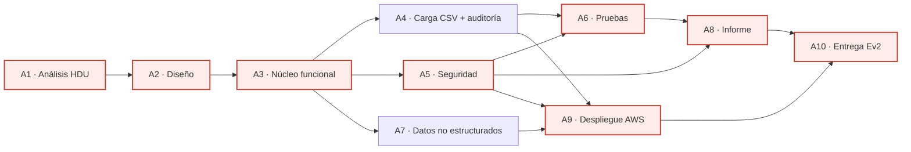

# Planificación del proyecto

> **Secciones 2.1.1.1 y 2.1.1.2 de la rúbrica · Evaluación 2 (Sumativa)**
> Asignatura: Proyecto Integrado (TIHI43) · INACAP · Profesor: Christian Pérez · Grupo **t420**
> Sistema: **Mantenedor de Calificaciones Tributarias (FactorUno)** · Cliente: **nuam**
> Repositorio: https://github.com/Gatoco/FactorUno

El presente capítulo documenta la planificación del proyecto con dos propósitos: **definir las actividades y fases bajo una metodología seleccionada** (sección 2.1.1.1) y **explicitar las dependencias y prioridades** entre las tareas del cronograma (sección 2.1.1.2). Se emplean tablas y diagramas para que la planificación sea verificable de un vistazo.

---

## 2.1.1.1 — Indica actividades y fases del proyecto siguiendo una metodología seleccionada

### Metodología seleccionada: Scrum

Se mantiene la metodología **Scrum**, ya seleccionada y justificada en la **Evaluación 1** (sección *"Selección de la metodología de desarrollo"*), donde se eligió por sobre Cascada y Kanban. Es coherente con este proyecto porque:

- los requisitos son **definidos pero evolutivos** (el cliente entregó Historias de Usuario en el archivo `HDU_Inacap.xlsx`);
- **nuam es un cliente presente y colaborativo**, con el que se validan los incrementos;
- el alcance se entrega por **incrementos funcionales** dentro del período anual de calificaciones;
- se alinea con la cultura del cliente, que declara trabajar con "metodologías ágiles orientadas al cliente y a la innovación".

Scrum organiza el trabajo en **sprints** (iteraciones cortas), con un **Product Backlog** priorizado, reuniones de planificación, revisiones con el cliente y una retrospectiva al cierre de cada iteración.

### Roles, artefactos y eventos de Scrum aplicados

| Elemento Scrum | Rol en el proyecto |
|---|---|
| **Product Owner** | nuam (aportó el HDU y valida el alcance) |
| **Scrum Master / Líder técnico** | Benjamín Cifuentes Vergara |
| **Equipo de desarrollo** | Grupo t420 |
| **Product Backlog** | Historias de Usuario del HDU (H1–H10), priorizadas |
| **Sprint Backlog** | Tareas técnicas de cada sprint (núcleo, seguridad, pruebas) |
| **Incremento** | Versión funcional del mantenedor desplegada y verificable |
| **Sprint Planning / Review / Retrospectiva** | Al inicio y al cierre de cada sprint |

### Fases y actividades del proyecto

Las fases combinan los **eventos de Scrum** con el **ciclo técnico real** del sistema (análisis → diseño → desarrollo → seguridad → pruebas → despliegue → entrega).

| # | Fase | Actividades principales | Entregable | Plazo | Responsable |
|---|---|---|---|---|---|
| 1 | **Inicio y análisis** | Levantamiento del HDU, identificación de necesidades, priorización del Product Backlog | Product Backlog priorizado | 18-08 → 05-09-2026 | Product Owner (nuam) + equipo |
| 2 | **Diseño** | Arquitectura 4+1, modelo de datos (entidades y llaves), definición del stack | Documento de diseño | 05-09 → 17-09-2026 | Equipo t420 |
| 3 | **Sprint 1 — núcleo funcional** | Grilla con filtros (mercado, origen, período), ingreso manual de calificaciones, cálculo de factores, auditoría básica | Incremento funcional núcleo | 21-09 → 02-10-2026 | Equipo t420 |
| 4 | **Sprint 2 — carga masiva** | Carga CSV de montos y factores, actualización por llave, validaciones de negocio, log de auditoría completo | Incremento de carga masiva | 05-10 → 09-10-2026 | Equipo t420 |
| 5 | **Sprint 3 — seguridad** | Autenticación (hash + sesión), autorización por roles, codificación segura, análisis de amenazas | Módulo de seguridad | 05-10 → 12-10-2026 | Equipo t420 |
| 6 | **Sprint 4 — calidad** | Pruebas unitarias, integrales y de rendimiento; herramientas automatizadas y manuales | Resultados de pruebas | 08-10 → 14-10-2026 | Equipo t420 |
| 7 | **Datos no estructurados** | Integración de DynamoDB (auditoría) y S3 (archivos CSV / exportes) desde la aplicación | Integración de datos no estructurados | 09-10 → 14-10-2026 | Equipo t420 |
| 8 | **Despliegue** | Instancia EC2 (RHEL 9), Docker Compose, IP elástica, verificación pública | Solución en la nube | 15-10-2026 | Equipo t420 |
| 9 | **Cierre y entrega** | Informe con la rúbrica como índice, documento único con enlaces, video de demostración | Entrega Evaluación 2 | 13-10 → 16-10-2026 | Equipo t420 + usuario |

### Diagrama de fases (flujo del proyecto)

### Cronograma del proyecto (línea de tiempo)

### Plazos y responsables

- **Hitos fijos (fuente: bitácora del proyecto):** Evaluación 1 el **18-09-2026**, despliegue en AWS el **15-10-2026** y entrega de la Evaluación 2 en la **semana del 12 al 18 de octubre de 2026 (viernes 16-10)**.
- **Fechas intermedias (supuesto):** las fechas de inicio y término de cada sprint corresponden al **cronograma planificado**; se derivan de los hitos fijos y de la disponibilidad del autor.
- **Responsables:** proyecto **individual** (grupo t420); todas las actividades se asignan a **Benjamín Cifuentes Vergara**, que cumple los roles de análisis funcional, desarrollo y despliegue.
- **Capacidad:** cada sprint mantiene plazos **alcanzables** porque reutiliza la base ya construida (el núcleo funcional existe desde antes de la Evaluación 1) y las iteraciones posteriores son incrementales sobre ese mismo código.

---

## 2.1.1.2 — Identifica dependencias y prioridades entre tareas del cronograma

### Tabla de dependencias entre actividades

Se identifican las dependencias de tipo **fin-a-comienzo (FS)**: una actividad no puede comenzar hasta que la que la precede haya terminado.

| ID | Actividad | Depende de | Precede a | Tipo | Ruta crítica |
|---|---|---|---|---|---|
| A1 | Análisis del HDU y priorización | — | A2 | — | Sí |
| A2 | Diseño de arquitectura y modelo de datos | A1 | A3 | FS | Sí |
| A3 | Núcleo funcional (grilla, ingreso, cálculo) | A2 | A4, A5, A7 | FS | Sí |
| A4 | Carga masiva CSV y auditoría | A3 | A6, A9 | FS | No |
| A5 | Seguridad (autenticación y autorización) | A3 | A6, A8, A9 | FS | Sí |
| A6 | Pruebas unitarias, integrales y de rendimiento | A4, A5 | A8 | FS | Sí |
| A7 | Datos no estructurados (DynamoDB / S3) | A3 | A9 | FS | No |
| A8 | Informe y documentación | A5, A6 | A10 | FS | Sí |
| A9 | Despliegue en AWS | A4, A5, A7 | A10 | FS | Sí |
| A10 | Entrega Evaluación 2 | A8, A9 | — | FS | Sí |

### Grafo de dependencias (ruta crítica destacada)

**Ruta crítica:** `A1 → A2 → A3 → A5 → A6 → A8 → A10`, con cierre en el despliegue `A9 → A10`. Cualquier retraso en el **núcleo funcional (A3)**, la **seguridad (A5)** o las **pruebas (A6)** retrasa la entrega, por lo que son las actividades que se vigilan con mayor atención. Las tareas **A4** y **A7** tienen holgura: pueden ejecutarse en paralelo sin bloquear el cierre.

### Prioridades según el marco MoSCoW

La priorización se centra en la **funcionalidad núcleo** que sostiene la demostración y en el puntaje de la rúbrica. Se aplica **MoSCoW** (Must / Should / Could / Won't).

| Prioridad | Funcionalidad | Justificación |
|---|---|---|
| **Must have** | Grilla de calificaciones con filtros (mercado, origen, período) | Es la pantalla base del sistema: sin ella no hay mantenedor que mostrar |
| **Must have** | Cálculo de factores (columnas 8–37, redondeo a 8 decimales, suma 8–19 ≤ 1) | Objetivo central del proyecto: convierte montos en factores |
| **Must have** | Carga masiva CSV con actualización por llave (upsert) | Automatiza el proceso anual y evita el ingreso manual repetitivo |
| **Must have** | Auditoría (ingreso, modificación, eliminación y carga) | Requisito de trazabilidad explícito del HDU |
| **Should have** | Autenticación y autorización por roles | Requisito de seguridad con el mayor peso de la rúbrica |
| **Should have** | Pruebas unitarias, integrales y de rendimiento | Alta ponderación en la rúbrica y respaldo de la calidad |
| **Should have** | Base no estructurada (DynamoDB / S3) | Complementa la base estructurada con historial y archivos |
| **Could have** | CRUD secundario y listados auxiliares | Útil, pero no crítico para la demostración ni para el puntaje |
| **Won't have (esta entrega)** | Módulo RAG (asistente de preguntas) e integración directa con el SII | El propio repositorio lo marca como "siguiente paso"; queda fuera del alcance |

**Criterio de priorización:** primero lo que sostiene la demostración funcional (**~80 % del sistema**, funcionalidades *Must have*); luego lo que aporta puntaje directo en la rúbrica (**seguridad y pruebas**, funcionalidades *Should have*); finalmente lo complementario (*Could have*). Las funcionalidades *Won't have* se excluyen explícitamente para no restar foco al núcleo.

---

## Fuentes y supuestos

- **Fuentes:** rúbrica oficial de Evaluación 2 (AAI); bitácora del proyecto (hitos, despliegue en AWS y estado); documento de Evaluación 1 (metodología Scrum y terminología); repositorio `Gatoco/FactorUno` (funcionalidades reales del sistema).
- **Supuestos:** las fechas intermedias de los sprints pertenecen al cronograma planificado; la composición nominal del grupo t420 (salvo Benjamín Cifuentes Vergara) no está registrada en la bitácora y se representa por rol.
