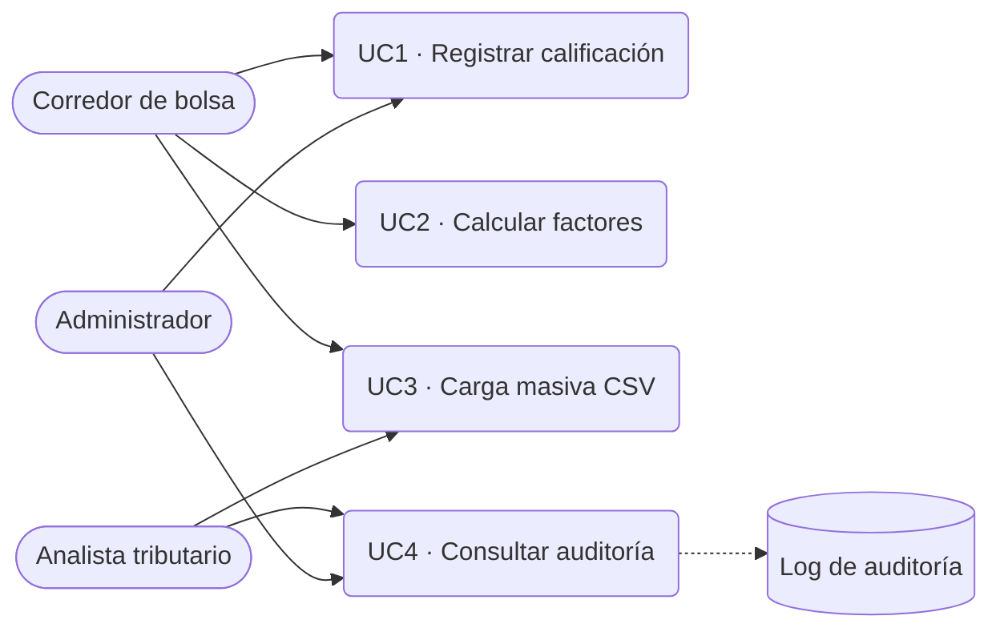
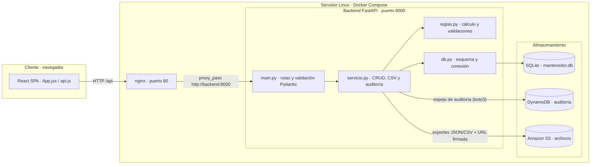
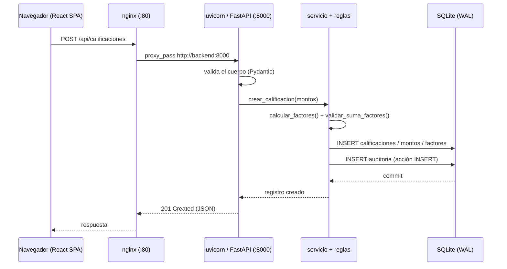
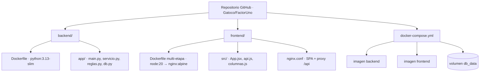
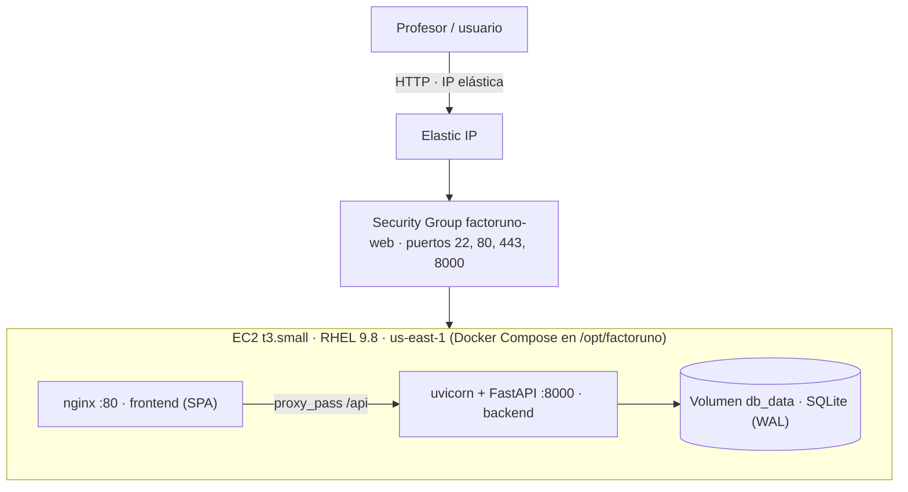

# Arquitectura del sistema

> **Secciones 2.1.2.3 y 2.1.2.4 de la rúbrica · Evaluación 2 (Sumativa)**
> Asignatura: Proyecto Integrado (TIHI43) · INACAP · Profesor: Christian Pérez · Grupo **t420**
> Sistema: **Mantenedor de Calificaciones Tributarias (FactorUno)** · Cliente: **nuam**
> Repositorio: https://github.com/Gatoco/FactorUno

Este capítulo describe la arquitectura de la solución en dos partes: los **puntos de vista del paradigma 4+1 de Kruchten** (sección 2.1.2.3) y la **justificación de las tecnologías y herramientas** de la infraestructura (sección 2.1.2.4). Cada vista se acompaña de un diagrama que la resume.

La solución es una aplicación web de tres capas: una **SPA en React** (presentación), una **API REST en FastAPI** (lógica y reglas de negocio) y una **base de datos SQLite** (datos), empaquetadas y orquestadas con **Docker Compose** sobre una instancia **EC2 con RHEL 9** en AWS.

---

## 2.1.2.3 — Define los puntos de vista del paradigma 4+1 (lógica, desarrollo, procesos, físico, escenarios)

El paradigma **4+1 de Kruchten** organiza la descripción de la arquitectura en cuatro vistas de diseño —**lógica, de procesos, de desarrollo y física**— más una **vista de escenarios** que integra y valida las anteriores.

| Vista | Pregunta que responde | Elementos centrales del sistema |
|---|---|---|
| **Escenarios** | ¿Qué hace el sistema y quién lo usa? | Casos de uso del corredor, analista y administrador |
| **Lógica** | ¿Cómo se descompone en componentes? | React SPA → nginx → FastAPI → SQLite |
| **Procesos** | ¿Cómo ocurre en ejecución y concurrencia? | Flujo de una petición, uvicorn y SQLite en modo WAL |
| **Desarrollo** | ¿Cómo se organiza el código y el despliegue? | Estructura del repositorio, imágenes Docker y Compose |
| **Física** | ¿Dónde se ejecuta en la infraestructura? | EC2 t3.small (RHEL 9), Elastic IP y security group |

### Vista de escenarios (casos de uso)

Resume las funcionalidades desde la perspectiva de los actores y sirve de hilo conductor del resto de las vistas.

| Caso de uso | Actor principal | Descripción |
|---|---|---|
| **UC1 · Registrar calificación** | Corredor | Ingreso manual de datos básicos y 29 montos; permite modificar y eliminar |
| **UC2 · Calcular factores** | Corredor | Convierte montos en factores (columnas 8–37), redondeo a 8 decimales y suma 8–19 ≤ 1 |
| **UC3 · Carga masiva CSV** | Corredor / Analista | Carga archivos de montos o factores, con actualización por llave (upsert) |
| **UC4 · Consultar auditoría** | Analista / Administrador | Consulta el historial de ingreso, modificación, eliminación y carga |

### Vista lógica (componentes)

Describe los componentes de software y sus relaciones. La separación en capas mantiene la lógica de negocio aislada de la interfaz y del almacenamiento.

> DynamoDB y Amazon S3 corresponden a la **base no estructurada** de la Evaluación 2 y están implementadas en `backend/app/aws_ext.py`; se activan por variables de entorno al desplegar y la aplicación degrada de forma limpia cuando no están configuradas.

El **backend** se organiza en cuatro módulos: `main.py` expone la API REST y valida la entrada con modelos Pydantic; `servicio.py` concentra las operaciones de negocio (listar, crear, modificar, eliminar, calcular, cargar CSV, auditar); `reglas.py` aplica las reglas del HDU (cálculo de factores, redondeo, validación de suma y tipo de sociedad); y `db.py` define el esquema y las conexiones. El **frontend** replica esa separación con `App.jsx` (pantalla principal), `api.js` (comunicación con el backend) y `columnas.js` (etiquetas y cálculo de la suma base).

### Vista de procesos

Describe el comportamiento en tiempo de ejecución, la concurrencia y la sincronización. La siguiente secuencia muestra el flujo de una petición típica de registro y cálculo.

Aspectos de procesos relevantes:

- **SQLite en modo WAL** (`PRAGMA journal_mode=WAL`): permite que las lecturas no bloqueen a las escrituras, lo que favorece la consulta de la grilla y la auditoría mientras se registran datos. Las claves foráneas se activan por conexión (`PRAGMA foreign_keys=ON`), garantizando la integridad referencial entre calificaciones, montos y factores.
- **uvicorn** ejecuta la aplicación FastAPI atendiendo cada petición HTTP; los puntos de entrada definidos como funciones síncronas se despachan en un pool de hilos, mientras que la carga de archivos se maneja de forma asíncrona.
- **Conexión por operación:** cada solicitud abre y cierra su conexión a SQLite, de modo que la escritura queda confirmada (commit) al finalizar y la auditoría se registra en la misma transacción que el cambio.
- **Contenedores independientes:** el frontend (nginx) y el backend (uvicorn) son procesos separados que se comunican por la red interna de Docker Compose.

### Vista de desarrollo

Muestra la organización del código y del despliegue: la estructura del repositorio, las imágenes Docker y la orquestación con Compose.

La organización es la siguiente:

- **`backend/`** contiene la aplicación FastAPI y su `Dockerfile`, que parte de `python:3.13-slim`, instala las dependencias de `requirements.txt` y arranca `uvicorn` en el puerto 8000.
- **`frontend/`** se compila con un `Dockerfile` **multi-etapa**: la primera etapa construye la SPA con Node 20 y Vite; la segunda la sirve con `nginx:alpine` y aplica `nginx.conf`, que sirve el SPA y redirige `/api/` al backend.
- **`docker-compose.yml`** orquesta los dos contenedores y declara el volumen **`db_data`**, donde persiste el archivo SQLite. En desarrollo los puertos se mapean como `5173:80` (frontend) y `8001:8000` (backend); en el servidor se exponen como `80` y `8000`.

### Vista física

Describe el despliegue sobre la infraestructura real en AWS Academy.

| Elemento físico | Detalle |
|---|---|
| **Instancia** | EC2 **t3.small**, sistema operativo **RHEL 9.8**, región `us-east-1` |
| **Dirección estable** | **Elastic IP** asignada a la instancia (en el despliegue de referencia, `100.56.124.163`) |
| **Security Group** | `factoruno-web`: puertos **22** (SSH), **80** (HTTP), **443** (HTTPS) y **8000** (API) |
| **Despliegue** | `docker compose up` sobre un clon del repositorio en `/opt/factoruno`, automatizado con cloud-init |
| **Persistencia** | Volumen Docker **`db_data`** con la base SQLite, independiente del ciclo de vida del contenedor |
| **Verificación en vivo del profesor** | El profesor levanta el laboratorio con la cuenta AWS del alumno, usa la **IP elástica** y revisa la solución en el navegador |

**Flujo de verificación en vivo:** el profesor inicia el AWS Academy Learner Lab con la cuenta del alumno, accede a `http://<IP elástica>` y comprueba la respuesta del frontend (HTTP 200) y de los endpoints `/api/calificaciones` y `/api/auditoria`. La **IP elástica** garantiza que la dirección no cambie entre reinicios de la instancia, de modo que la revisión es reproducible. El laboratorio es efímero (se apaga tras unas horas), por eso la entrega incluye el **correo de la cuenta AWS y la IP elástica**: con ellos el profesor puede levantar el entorno y verificar la solución en vivo.

---

## 2.1.2.4 — Especifica las tecnologías y herramientas requeridas para la infraestructura

Se detallan las tecnologías que componen la solución, su rol, las alternativas evaluadas y la justificación de cada elección.

| Tecnología | Rol en la solución | Alternativas consideradas | Justificación |
|---|---|---|---|
| **FastAPI** (Python) | API REST y reglas de negocio del backend | Flask, Django REST Framework, Node/Express | Validación estricta de entrada con Pydantic, soporte nativo para operaciones asíncronas y documentación OpenAPI automática; adecuado para reglas de negocio precisas (cálculo y redondeo) |
| **React + Vite** | SPA: grilla con filtros, formularios y carga de archivos | Vue, Svelte, HTML + JavaScript plano | React es el estándar para interfaces interactivas; Vite acelera el desarrollo (HMR) y produce un build estático optimizado que sirve nginx |
| **SQLite (modo WAL)** | Base de datos estructurada: calificaciones, montos, factores y auditoría | PostgreSQL, MySQL | No requiere servidor de base de datos aparte, persiste en un único archivo dentro del volumen y el modo WAL permite lecturas concurrentes; suficiente para el volumen anual del proceso (integridad referencial activada) |
| **Docker Compose** | Orquestación del frontend y el backend | Kubernetes, instalación manual | Empaqueta toda la aplicación y hace el despliegue **reproducible** con el mismo stack en desarrollo y en el servidor, en pocos minutos y sin dependencias manuales |
| **nginx** | Servidor de archivos estáticos y reverse proxy | Apache, Caddy | Ligero y eficiente: sirve el SPA y redirige `/api/` al backend, evitando problemas de CORS en el despliegue |
| **RHEL 9** | Sistema operativo del servidor | Ubuntu, Debian, Amazon Linux | **Recomendación explícita del profesor** (Red Hat), que además responde al contexto empresarial del cliente |
| **EC2 t3.small** | Cómputo en la nube para la aplicación | t2.micro, AWS Lambda, contenedores gestionados | Tamaño suficiente para dos contenedores y una base SQLite, con disponibilidad dentro del AWS Academy Learner Lab |
| **AWS Academy Learner Lab** | Entorno de nube provisto por la asignatura | Cuenta AWS propia, capa gratuita | Es el entorno con el que el profesor verifica la solución usando la **cuenta del alumno** y la **IP elástica** |
| **Amazon DynamoDB** | Base no estructurada para el historial de auditoría | MongoDB, Redis | Servicio gestionado y sin servidor; adecuado para el historial de eventos de auditoría |
| **Amazon S3** | Almacenamiento de CSV originales y exportes JSON | Almacenamiento en el sistema de archivos local | Almacenamiento de objetos durable y accesible, idóneo para archivos de carga y respaldos |
| **boto3** | SDK de AWS para integrar DynamoDB y S3 desde la aplicación | AWS CLI, otro SDK | Es el SDK oficial de Python, integrado en el mismo backend FastAPI |

### ¿Por qué nube?

El profesor exige que la solución esté **disponible en la nube** para que **cualquier persona pueda revisarla**. En este proyecto, la nube cumple tres propósitos concretos:

1. **Revisión en vivo por parte del profesor.** La entrega incluye el **correo de la cuenta AWS y la IP elástica**; con ellos el profesor levanta el AWS Academy Learner Lab y verifica la solución funcionando en tiempo real, sin depender de una demostración local.
2. **Dirección estable y reproducible.** La **Elastic IP** fija la dirección de la aplicación, de modo que la revisión no se rompe entre reinicios de la instancia, y el despliegue con **Docker Compose** puede repetirse en minutos.
3. **Contexto realista del negocio.** El proceso anual de calificaciones requiere que los corredores accedan al mantenedor desde cualquier lugar durante el período de alta demanda; la nube aporta esa **disponibilidad** y la posibilidad de **escalar** el servidor según la carga.

---

## Fuentes y supuestos

- **Fuentes:** rúbrica oficial de Evaluación 2 (AAI); bitácora del proyecto (datos de despliegue: EC2 t3.small, RHEL 9.8, Elastic IP, security group 22/80/443/8000 y verificación pública); repositorio `Gatoco/FactorUno` (`README.md`, `docker-compose.yml`, `backend/app/*`, `frontend/*`).
- **Supuestos:** los puertos de despliegue (`80` y `8000`) se ajustan respecto de los valores de desarrollo (`5173:80` y `8001:8000`) del `docker-compose.yml` del repositorio. Las integraciones DynamoDB y S3 están implementadas en `backend/app/aws_ext.py` y se activan por variables de entorno al desplegar en la nube; sin ellas la aplicación opera solo con SQLite.
