## 2.1.3.5 Prototipos interactivos

El prototipo de la solución evolucionó hasta convertirse en una **aplicación web completamente funcional e interactiva** (no solo pantallas estáticas): el mantenedor FactorUno permite navegar, filtrar, ingresar datos, calcular factores y auditar operaciones en tiempo real. Esto supera el nivel de un prototipo de baja fidelidad y se alinea directamente con el requisito del profesor de demostrar la funcionalidad del sistema en vivo.

El prototipo se construyó con la misma tecnología del producto final (**React + Vite** en el frontend, **FastAPI** en el backend), por lo que cada iteración fue directamente reutilizable. El flujo principal implementado es:

1. **Inicio de sesión** con usuario y contraseña (roles `admin`, `analista`, `consulta`).
2. **Grilla de calificaciones** con filtros por mercado, origen y período.
3. **Detalle de un registro** con sus montos y factores calculados.
4. **Ingreso manual** de una calificación (datos básicos + 29 montos).
5. **Carga masiva** por archivo CSV, con **previsualización y validación de formato** antes de grabar.
6. **Cálculo automático** de factores con redondeo a 8 decimales; la suma base (columnas 8–19) se muestra en vivo y alerta si supera 1.
7. **Auditoría** de todas las operaciones (creación, modificación, eliminación, cálculo y carga).
8. **Exportación** del respaldo completo (JSON o CSV) publicada en S3 con URL firmada temporal.

Las siguientes capturas corresponden a la aplicación ejecutándose:

| Nº | Pantalla | Descripción |
|----|----------|-------------|
| 1 | Inicio de sesión | Autenticación con rol; bloquea el acceso al sistema sin credenciales. |
| 2 | Grilla principal | Listado de calificaciones con filtros por mercado, origen y período. |
| 3 | Detalle del registro | Montos por columna y factores calculados (8 decimales, suma ≤ 1). |
| 4 | Auditoría | Historial de operaciones con usuario, acción, registro y fecha. |
| 5 | Ingreso manual | Formulario de datos básicos del certificado. |
| 6 | Montos | Pestaña de los 29 montos por columna (8–36), agrupados por concepto de la homologación SII. |
| 7 | Vista móvil (grilla) | La grilla se convierte en tarjetas en pantalla de teléfono (390 × 962). |
| 8 | Factores | Factores calculados con la suma base (8–19) en vivo y alerta si supera 1. |
| 9 | Previsualización de carga | Validación del CSV antes de grabar: registros, columnas y avisos por fila. |
| 10 | Exportación | Respaldo JSON/CSV publicado en S3 con URL firmada. |
| 11 | Vista móvil (formulario) | El modal de ingreso se apila en una columna, con la etiqueta sobre cada campo. |

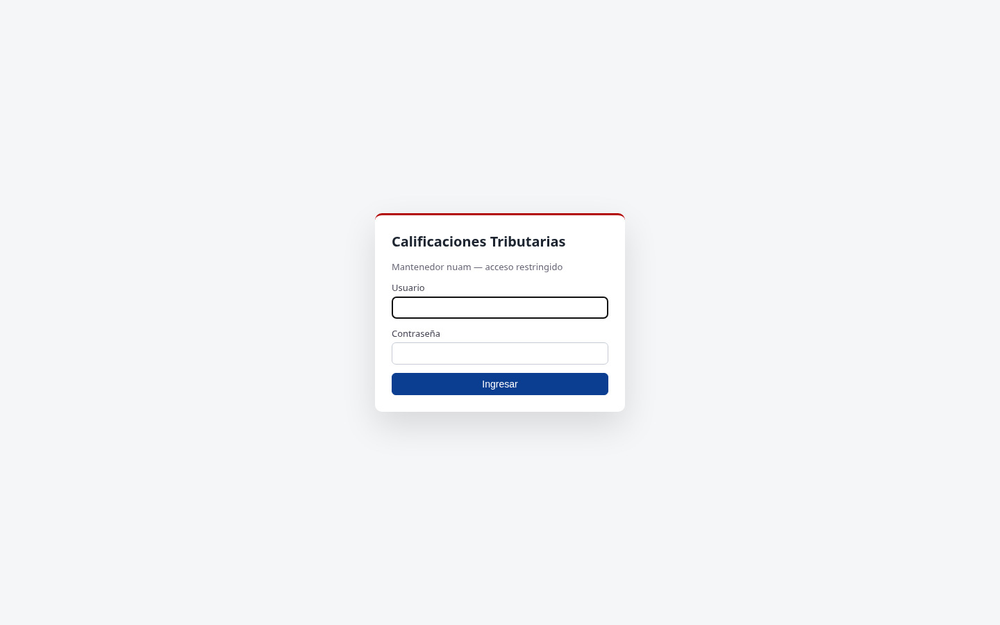

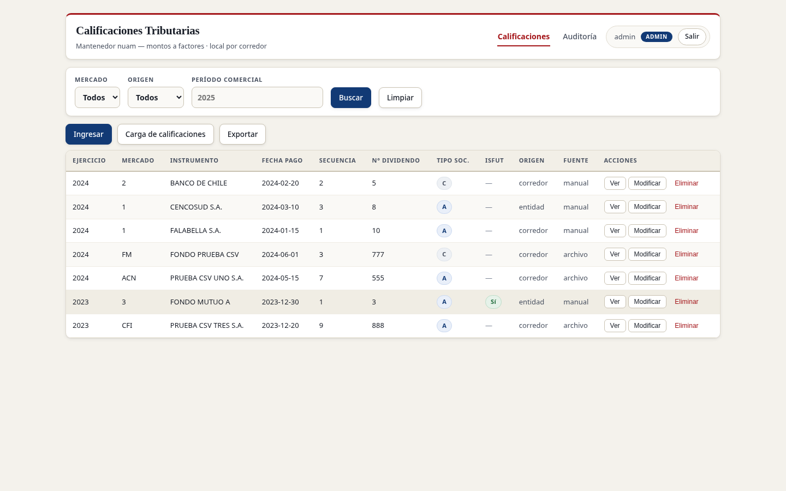

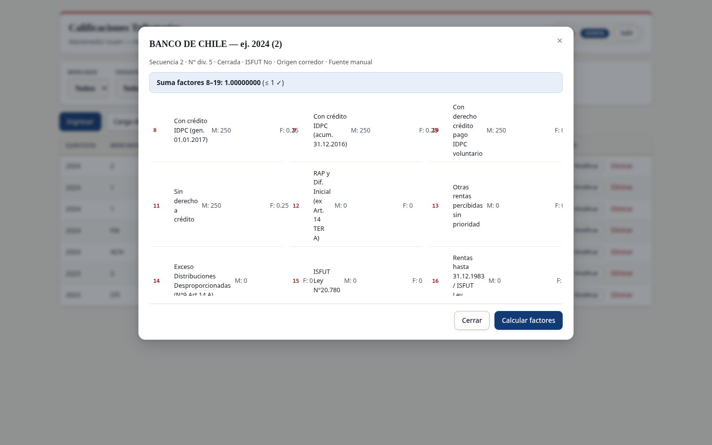

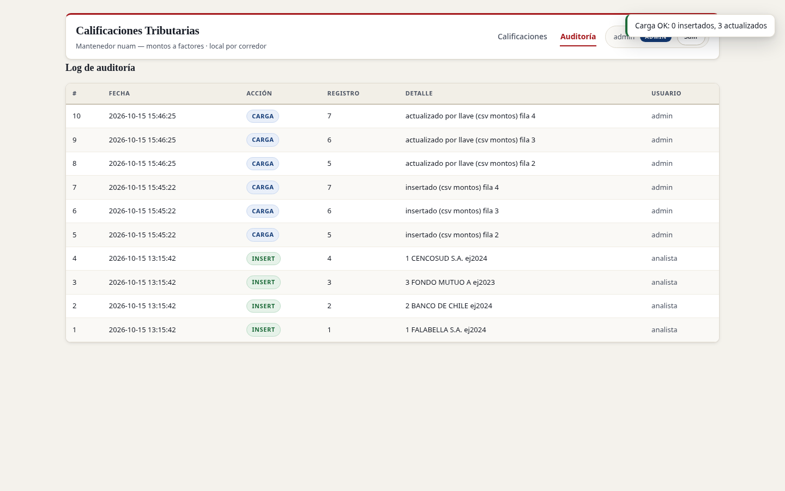

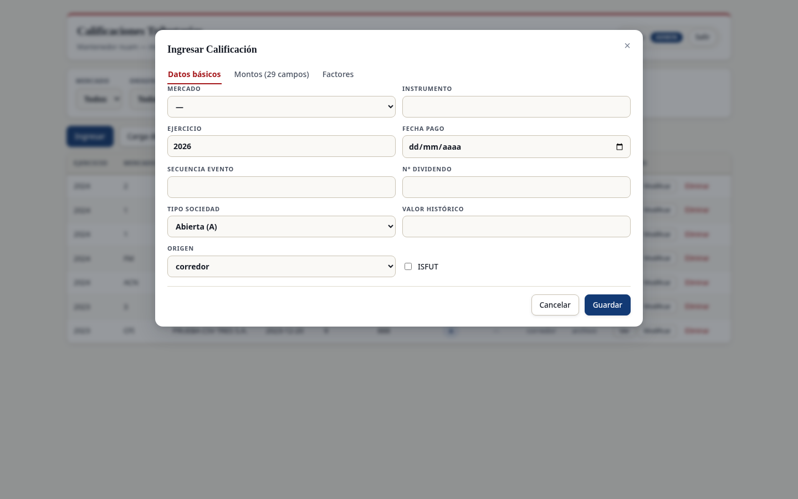

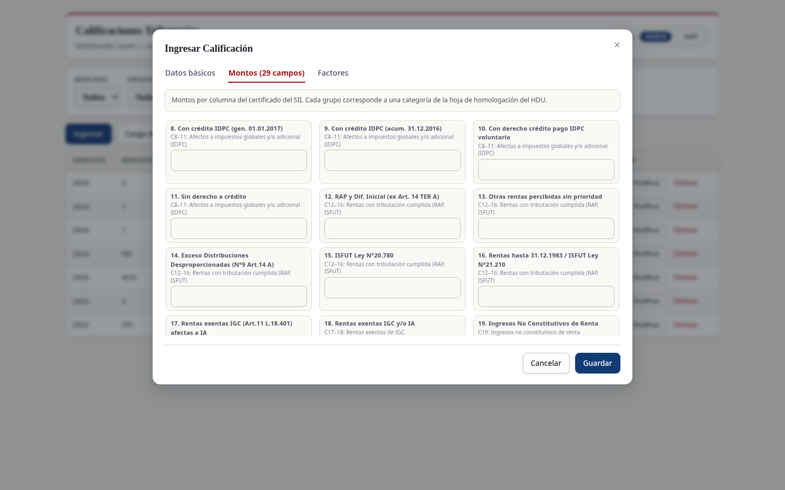

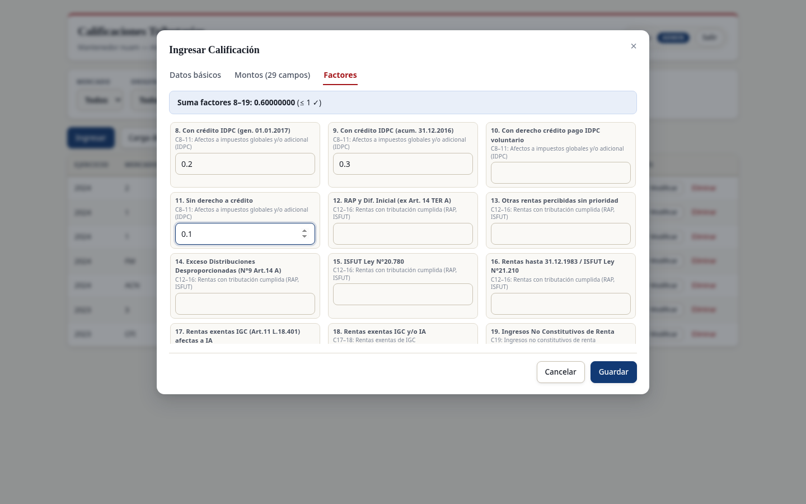

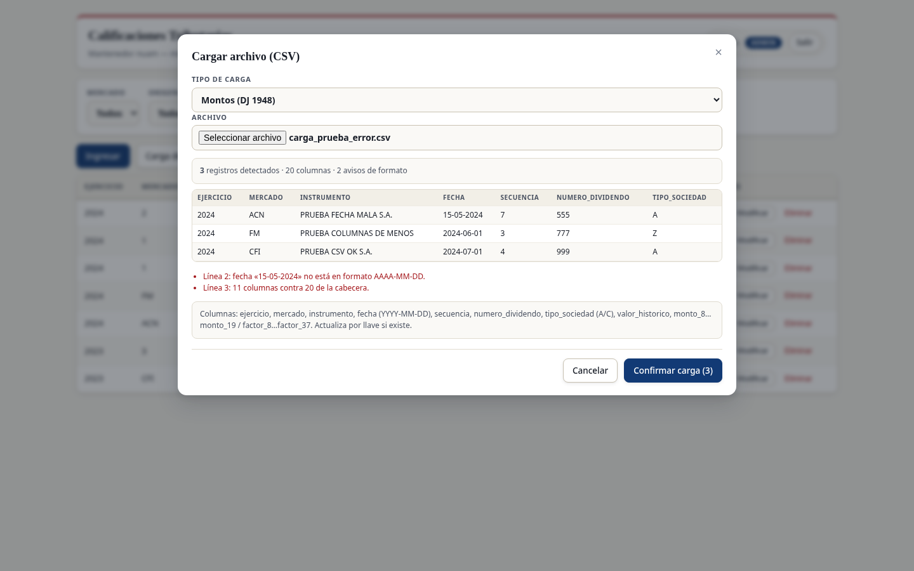

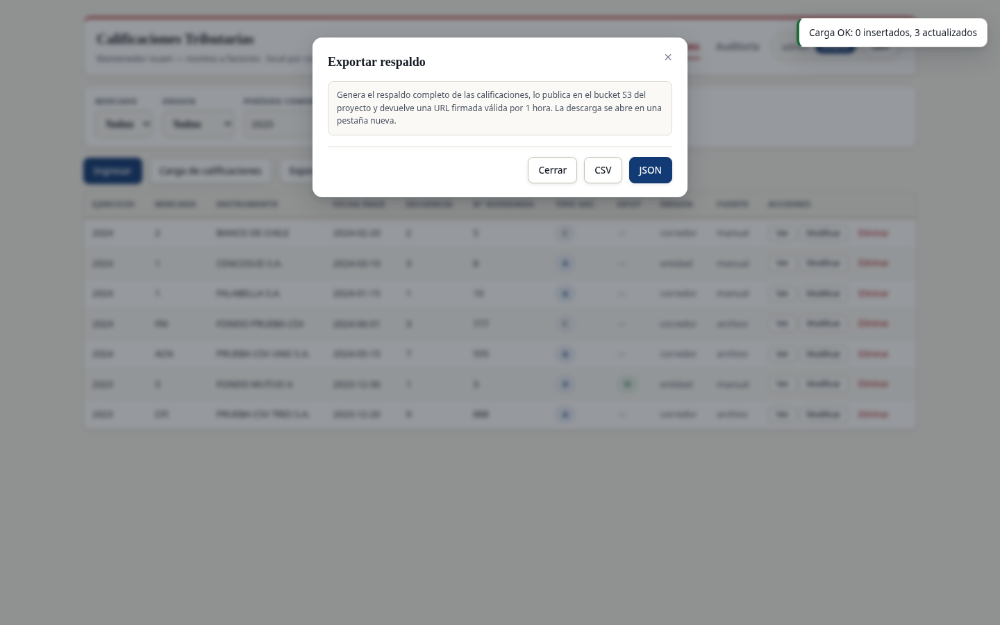

## 2.1.3.6 Consistencia visual y adaptabilidad

La interfaz aplica un **sistema de diseño único** en todas las vistas, lo que garantiza consistencia visual:

- **Tipografía**: pareja tipográfica deliberada — serif editorial (Georgia) para títulos y jerarquías, tipografía de sistema para cuerpo y datos; números tabulares alineados en grillas y modales.
- **Paleta**: azul institucional como color primario de acciones, rojo institucional como acento de marca (borde superior, pestaña activa, numerales de columnas) y para acciones destructivas, fondo crema de papel, verde para estados correctos y grises neutros para estructura.
- **Componentes reutilizables**: botones, tarjetas, modales (detalle, ingreso, montos), tablas y pestañas mantienen el mismo aspecto y comportamiento en toda la aplicación.
- **Retroalimentación**: mensajes de error del backend se muestran al usuario sin ambigüedad (por ejemplo, al intentar ingresar sin sesión o al enviar datos inválidos).

La **adaptabilidad** está resuelta con una hoja de estilos responsiva con dos puntos de quiebre: en pantallas pequeñas la barra de navegación y los formularios se apilan en una sola columna y, bajo 560 px, la grilla abandona el desplazamiento horizontal y se convierte en **tarjetas**, una por calificación, con la etiqueta de cada campo al costado del valor. Las capturas 7 y 11 demuestran la aplicación renderizada en un viewport móvil (390 × 962 px) —la grilla como tarjetas y el modal de ingreso apilado—, manteniendo legibilidad y operabilidad de las acciones principales.

| Aspecto | Criterio aplicado | Evidencia |
|---------|-------------------|-----------|
| Consistencia tipográfica | Jerarquías únicas en todas las vistas | Capturas 1–6 |
| Consistencia de color | Paleta institucional única (azul primario, rojo de acento, fondo crema) en todas las vistas | Capturas 2, 3, 6 |
| Consistencia de componentes | Modales, tablas y botones homogéneos | Capturas 3, 5, 6 |
| Adaptabilidad | Layout responsivo usable en móvil (grilla en tarjetas y formularios apilados) | Capturas 7, 11 |

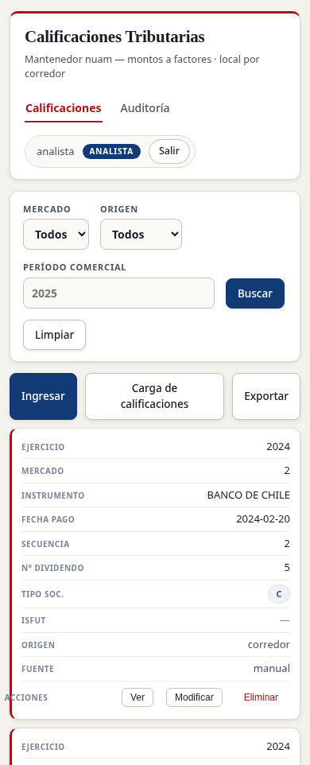

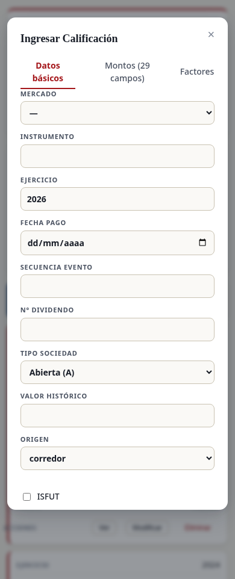

## 2.1.3.7 Retroalimentación de usuarios

> **Nota de alcance.** Esta sección describe el mecanismo de retroalimentación adoptado por el equipo y aplica los hallazgos ya incorporados durante el desarrollo (iteraciones internas y ajustes derivados del material del cliente). Los instrumentos de validación con usuarios del proceso (checklist heurístico y encuesta breve) quedan definidos en esta sección y **sus resultados se anexan al cierre de la entrega**.

La retroalimentación se gestionó en dos ciclos:

1. **Durante el desarrollo (aplicada).** Cada demostración interna del flujo principal (grilla → detalle → cálculo) generó ajustes concretos incorporados al prototipo:
   - el detalle pasó de una pantalla aparte a un **modal en contexto** sobre la grilla, reduciendo clics para revisar factores;
   - el ingreso de montos se dividió en pestañas (datos básicos / 29 montos) para evitar un formulario excesivamente largo;
   - los errores de validación del backend (suma de factores mayor a 1, formato de fecha, tipo de sociedad inválido) se muestran junto al campo correspondiente o en el modal, en vez de fallar silenciosamente;
   - se añadió el filtro por **período** tras comprobar que revisar años anteriores era una de las necesidades más frecuentes.

2. **Validación con usuarios del proceso (instrumento preparado).** Para cerrar el ciclo se definió un **checklist heurístico** (claridad de la grilla, facilidad del ingreso de montos, comprensión del resultado del cálculo, confianza en la auditoría) y una **encuesta breve** de 4 preguntas aplicable a usuarios del proceso:

| # | Pregunta | Escala |
|---|----------|--------|
| 1 | ¿La grilla y sus filtros le permiten encontrar una calificación rápidamente? | 1 (muy difícil) – 5 (muy fácil) |
| 2 | ¿El ingreso de los 29 montos le resultó claro y sin errores? | 1 – 5 |
| 3 | ¿Confía en el resultado del cálculo de factores que muestra el sistema? | 1 – 5 |
| 4 | ¿La auditoría le entrega la trazabilidad que su rol necesita? | 1 – 5 |

Los resultados de esta encuesta se incorporarán al informe final de la entrega, junto con las mejoras implementadas a partir de ellos.
