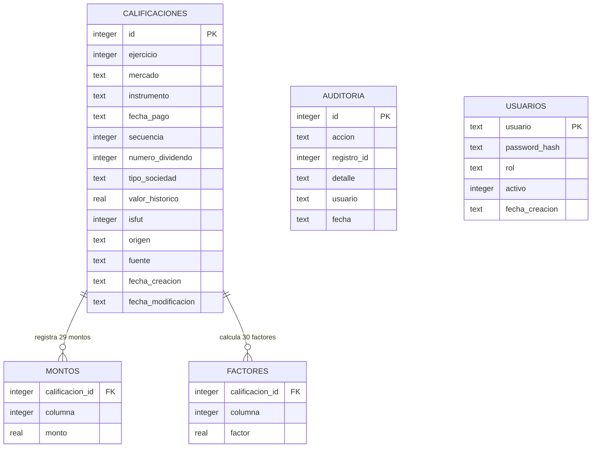

## 2.1.4.8 Entidades y relaciones

El modelo de datos del mantenedor es relacional y está implementado en **SQLite**. Se compone de cinco tablas: `calificaciones` (entidad central), `montos`, `factores`, `auditoria` y `usuarios`.



**Reglas de integridad aplicadas en la base de datos:**

| Regla | Implementación |
|-------|----------------|
| Clave primaria de negocio | Índice `UNIQUE` sobre (ejercicio, mercado, instrumento, fecha_pago, secuencia, numero_dividendo, tipo_sociedad): impide duplicar un certificado; habilita el *upsert* de la carga masiva. |
| Integridad referencial | `montos` y `factores` referencian a `calificaciones` con `FOREIGN KEY … ON DELETE CASCADE`; `PRAGMA foreign_keys=ON` en cada conexión. |
| Dominios cerrados | `CHECK` para `mercado` (1–3), `tipo_sociedad` (A/C), `origen` (corredor/entidad), `fuente` (manual/archivo/sistema) y rango de columna de montos/factores (8–37). |
| Integridad de negocio | La suma de factores de las columnas 8 a 19 no puede superar 1 (validado por la aplicación, con tolerancia de 1e-8) y los factores se redondean a 8 decimales (`ROUND_HALF_UP`). |
| Trazabilidad | Toda operación de creación, modificación, eliminación, cálculo y carga escribe un evento en `auditoria` con el usuario autenticado. |
| Concurrencia y durabilidad | SQLite en modo **WAL** (`journal_mode=WAL`), transacciones por operación. |

La entidad `usuarios` sostiene la autenticación: almacena el hash **bcrypt** de la contraseña (nunca la contraseña), el rol (`admin`, `analista`, `consulta`) y el estado activo/inactivo.

## 2.1.4.9 Base de datos estructurada y no estructurada

La solución usa **ambos tipos de almacenamiento**, integrados desde la propia aplicación:

| Almacenamiento | Tipo | Contenido | Rol en la solución |
|----------------|------|-----------|--------------------|
| **SQLite** (volumen Docker `db_data`) | Estructurada (relacional) | Calificaciones, montos, factores, usuarios y auditoría | Núcleo transaccional: toda la operatoria del mantenedor (grilla, cálculo, carga masiva) consulta y escribe aquí. |
| **Amazon DynamoDB** | No estructurada (clave-valor/documento) | Espejo del historial de auditoría | Historial de solo-anexado, desacoplado del volumen transaccional; sirve de respaldo y permite consultas externas sin tocar la base operacional. |
| **Amazon S3** | No estructurada (objetos) | Exportes JSON y CSV del mantenedor (y archivos originales que se cargan) | Evidencia descargable y respaldo de archivos; entrega URLs firmadas temporales para su descarga. |

**DynamoDB.** Cada evento de auditoría se espeja a la tabla configurada en `FACTORUNO_DYNAMO_TABLA` con la forma:

```json
{
  "id": "2026-10-15T13:05:22#CREAR#4#123456",
  "accion": "CREAR",
  "registro_id": 4,
  "detalle": "CENCOSUD S.A. 2024-03-10",
  "usuario": "analista",
  "fecha": "2026-10-15 13:05:22"
}
```

La clave `id` combina fecha, acción, registro y microsegundos para garantizar unicidad sin coordinación. El espejo es **best-effort**: si AWS no está configurado o falla, la operación principal continúa (la auditoría local en SQLite es siempre la fuente de verdad).

**Amazon S3.** El endpoint `GET /api/exportar?formato=json|csv` genera la exportación completa del mantenedor (registros con montos y factores + últimas 500 auditorías) y la sube al bucket `FACTORUNO_S3_BUCKET`, devolviendo una **URL firmada válida por 1 hora**:

| Formato | Objeto generado | Uso |
|---------|-----------------|-----|
| JSON | `factoruno-AAAAMMDD-HHMMSS.json` | Respaldo íntegro para revisión o re-importación. |
| CSV | `factoruno-AAAAMMDD-HHMMSS.csv` | Entrega tabular interoperable (Excel). |

**Degradación limpia.** Toda la integración AWS se activa por variables de entorno (`FACTORUNO_DYNAMO_TABLA`, `FACTORUNO_S3_BUCKET`, `AWS_REGION`). Sin ellas, la aplicación opera igual con SQLite y responde `503` con un mensaje claro en el endpoint de exportación; en el despliegue de la nube ambas quedan configuradas y las funciones se habilitan. Esto permite que el desarrollo y las pruebas locales no dependan de credenciales AWS.
