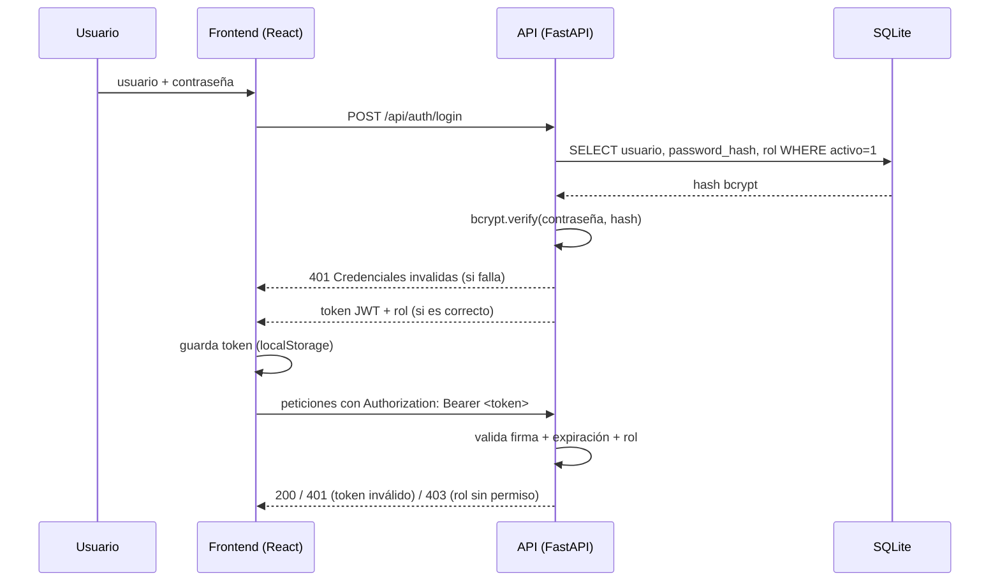

## 2.1.5.10 Políticas de autenticación y autorización

El sistema implementa políticas **explícitas** de autenticación y autorización, aplicadas en el backend (fuente de verdad) y reflejadas en la interfaz.

### Mecanismo de autenticación

1. El usuario envía sus credenciales a `POST /api/auth/login`.
2. El backend verifica la contraseña contra el **hash bcrypt** almacenado (nunca texto plano) y que el usuario esté activo.
3. Si son válidas, emite un **token JWT firmado con HS256** (`sub`, `rol`, `iat`, `exp`), con expiración configurable por entorno (8 horas por defecto).
4. Cada petición protegida envía `Authorization: Bearer <token>`; el backend valida firma, vigencia y rol; si el token expira o es inválido responde `401` y el frontend limpia la sesión y vuelve al login.

### Política de autorización: matriz de roles

Se definen tres roles con un principio de **mínimo privilegio**:

| Operación | `consulta` | `analista` | `admin` |
|-----------|:----------:|:----------:|:-------:|
| Ver grilla y detalle de calificaciones | ✅ | ✅ | ✅ |
| Crear / modificar / eliminar calificaciones | ❌ (403) | ✅ | ✅ |
| Calcular factores de un registro | ❌ (403) | ✅ | ✅ |
| Carga masiva por CSV | ❌ (403) | ✅ | ✅ |
| Ver auditoría | ❌ (403) | ✅ | ✅ |
| Exportar a S3 (JSON/CSV) | ❌ (403) | ✅ | ✅ |

- `consulta`: perfil de **solo lectura** para revisar calificaciones sin poder alterar nada (por ejemplo, un auditor externo o un usuario de consulta de la Bolsa).
- `analista`: operación diaria del corredor (ingreso, cálculo, carga masiva, auditoría).
- `admin`: mismas capacidades que `analista` más la administración de usuarios (creados por semilla/entorno; el rol no habilita operaciones destructivas adicionales sobre datos de negocio).

### Aplicación de las políticas

- **En la API:** cada endpoint protegido declara su dependencia de autenticación (`get_current_user`) y, cuando corresponde, de rol (`requiere_rol("admin","analista")`). Sin token válido la respuesta es `401`; con token de rol insuficiente, `403`. La suite de pruebas verifica la matriz completa (16 pruebas dedicadas).
- **En la interfaz:** la UI oculta o deshabilita las acciones según el rol (pestaña Auditoría, botones Ingresar, Carga CSV, Modificar, Eliminar, Calcular). Se documenta explícitamente que **la UI no es un control de seguridad**: aunque se manipule el cliente, la API rechaza cualquier operación no autorizada.
- **Trazabilidad:** cada operación registra en la auditoría el **usuario autenticado real** que la ejecutó (no un valor fijo), de modo que la matriz de roles es verificable sobre los hechos.
- **Gestión de secretos:** el secreto JWT y las contraseñas semilla se inyectan por variables de entorno (`.env.example` documenta las claves; `.env` no se versiona). En producción se define un secreto fuerte al desplegar.

### Alineación con buenas prácticas

| Práctica (OWASP ASVS / Top 10) | Aplicación en FactorUno |
|--------------------------------|--------------------------|
| Hash robusto de credenciales | bcrypt con salt por usuario. |
| Sesiones con expiración | JWT con `exp` (8 h) y validación en cada petición. |
| Control de acceso centralizado | Dependencias FastAPI por endpoint; matriz único en `auth.py`. |
| Mínimo privilegio | Tres roles; `consulta` sin escritura ni auditoría. |
| No filtrar información | `401`/`403` genéricos; errores de validación acotados. |
| Registro de auditoría | Cada acción con usuario, fecha y detalle. |

**Limitación declarada:** no se implementó limitación de tasa (rate limiting) en el login; se mitiga parcialmente con la latencia de bcrypt y la auditoría de accesos fallidos. Queda identificado como riesgo residual en el análisis de amenazas (sección 2.1.5.11) y como trabajo futuro.
