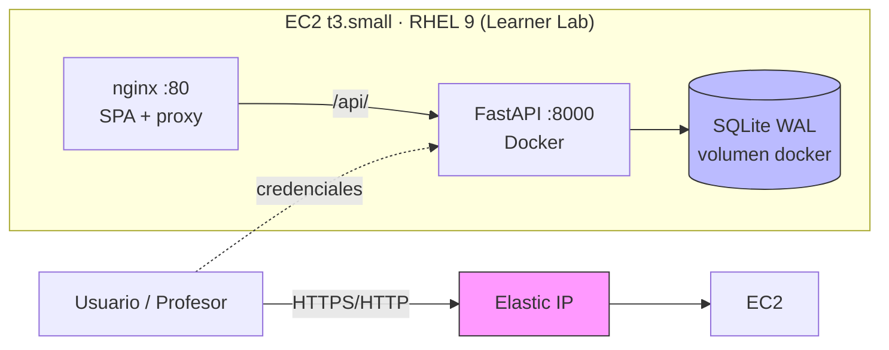

# 2.1.5.11 Identificación de amenazas y medidas de mitigación

> Análisis de amenazas del Mantenedor de Calificaciones Tributarias (FactorUno)
> aplicando la metodología **STRIDE** sobre la arquitectura desplegada en AWS.
> Fecha: octubre de 2026. Autores: grupo t420.

## 1. Alcance y activos

| Activo | Descripción | Exposición |
|---|---|---|
| Datos tributarios | Calificaciones, montos (columnas 8–19) y factores (8–37) de instrumentos financieros | API pública vía Elastic IP |
| Credenciales de usuario | Usuarios `admin`, `analista`, `consulta` con contraseña hasheada | Formulario de login |
| Tokens de sesión | JWT firmados (HS256, expiración 8 h) | Almacenados en el navegador (localStorage) |
| Registro de auditoría | Trazabilidad de INSERT/UPDATE/DELETE/CALCULAR/CARGA con usuario real | Solo roles admin/analista |
| Infraestructura | EC2 t3.small (RHEL 9), contenedores Docker, nginx, SQLite (WAL) | Security Group 22/80/443/8000 |

## 2. Arquitectura y límites de confianza

Límites de confianza: (1) Internet ↔ Elastic IP, (2) nginx ↔ backend, (3) backend ↔ base de datos, (4) usuario ↔ API de autenticación.

## 3. Análisis STRIDE

### S — Spoofing (suplantación de identidad)

| Amenaza | Vector | Mitigación implementada |
|---|---|---|
| Suplantar a un usuario con credenciales robadas | Fuerza bruta o filtración | Contraseñas con hash **bcrypt** (nunca en texto plano); token JWT firmado HS256 con expiración configurable (`FACTORUNO_TOKEN_HORAS`, por defecto 8 h) |
| Falsificar un token | Manipular el JWT en el navegador | Firma verificada en cada petición; token inválido → **401** (`app/auth.py:get_current_user`) |

Limitación conocida: no hay *rate limiting* en el login (ver §5).

### T — Tampering (manipulación de datos)

| Amenaza | Vector | Mitigación implementada |
|---|---|---|
| Modificar montos/factores sin autorización | Petición directa a la API | Todos los endpoints de escritura exigen rol **admin/analista** (`Depends(auth.requiere_rol(...))`) |
| Inyección SQL | Payloads en filtros o campos | Consultas **parametrizadas** en todo `servicio.py`; el `UPDATE` dinámico usa una *whitelist* fija de columnas |
| CSV malicioso (fórmulas, tipos inválidos) | Carga masiva | Validación campo a campo con Pydantic + `reglas.py`; filas inválidas se rechazan individualmente y se reportan en `errores[]` |
| Alterar la regla de negocio (suma de factores ≤ 1) | Enviar factores manuales | `validar_suma_factores` se ejecuta en crear, modificar, calcular y cargar (umbral 1,00000001) |

### R — Repudiation (repudio)

| Amenaza | Vector | Mitigación implementada |
|---|---|---|
| Negar haber modificado un registro | Falta de trazabilidad | Tabla `auditoria`: cada INSERT/UPDATE/DELETE/CALCULAR/CARGA registra **usuario autenticado real**, acción, registro y fecha (`db.py:audit`) |
| Ocultar el origen de una carga masiva | Carga por archivo | Cada fila cargada genera evento CARGA con número de fila |

### I — Information Disclosure (divulgación de información)

| Amenaza | Vector | Mitigación implementada |
|---|---|---|
| Leer datos sin autenticarse | Acceso anónimo | **Todos** los endpoints `/api/*` (excepto login) exigen token; sin token → 401 |
| Robo de datos por XSS | Scripts inyectados en la SPA | CSP `default-src 'self'`, `script-src 'self'`; React escapa la salida por defecto |
| Fuga de detalles técnicos | Errores 500 con trazas | Errores controlados con `HTTPException` y mensajes genéricos; validación previa evita estados inconsistentes |
| CORS abierto | Orígenes arbitrarios | Lista explícita `FACTORUNO_CORS_ORIGINS` (por defecto solo `localhost:5173`) |

### D — Denial of Service (denegación de servicio)

| Amenaza | Vector | Mitigación implementada |
|---|---|---|
| Saturación del servidor | Peticiones masivas | Instancia y lab efímeros (4 h), lo que acota la ventana de exposición; operaciones acotadas por rol |
| CSV gigantesco | Archivo de carga enorme | Validación fila a fila con reporte de errores; límite de tamaño de carga pendiente (§5) |

### E — Elevation of Privilege (elevación de privilegios)

| Amenaza | Vector | Mitigación implementada |
|---|---|---|
| Usuario `consulta` escribiendo | Petición directa | `requiere_rol("admin","analista")` → **403**; matriz de roles verificada por tests (16 casos en `tests/test_auth.py`) |
| Escalar rol manipulando el JWT | Editar payload `rol` | El rol viaja firmado; cualquier manipulación invalida la firma → 401 |
| Acceso al contenedor o la base | Escapes de contenedor | Docker Compose con servicios aislados; SQLite solo accesible desde el backend; RHEL 9 con SELinux |

## 4. Seguridad de la infraestructura

| Control | Implementación |
|---|---|
| Segmentación de red | Security Group `factoruno-web` limitado a 22/80/443/8000 |
| Sistema operativo | **RHEL 9** (recomendación explícita del docente): SELinux, firewalld, ciclo de parches |
| Contenedores | Imágenes oficiales fijadas (`python:3.13-slim`, `node:20`, `nginx:alpine`) |
| Secretos | Variables de entorno (`FACTORUNO_SECRET`, contraseñas), nunca en el repositorio (`.env` en `.gitignore`) |
| Exposición | IP elástica dedicada; lab apagado al terminar la revisión |
| Reproducibilidad | `docker compose up` sobre clon del repositorio (`main`), despliegue repetible en ~5 min |

## 5. Riesgos residuales y trabajo futuro

| Riesgo residual | Motivo | Plan |
|---|---|---|
| Sin rate limiting en login | Dependencia no incluida | Añadir `slowapi`/tokens por IP; bcrypt ya limita la tasa efectiva |
| Sin HTTPS en el despliegue de revisión | Lab con IP directa | Terminar TLS en nginx (Let's Encrypt o certificado autofirmado) |
| Sin límite de tamaño de subida | Simplificación | Límite de N MB en `POST /api/carga` y en nginx (`client_max_body_size`) |
| Token en localStorage | Simplicidad SPA | Migrar a cookie httpOnly + CSRF token |
| Sin monitoreo/alertas | Alcance académico | CloudWatch básico en un despliegue productivo |

## 6. Trazabilidad amenaza → control → evidencia

| Amenaza | Control | Evidencia |
|---|---|---|
| Suplantación | bcrypt + JWT | `app/auth.py`; `tests/test_auth.py::test_login_con_password_incorrecta_retorna_401` |
| Escritura sin permiso | Matriz de roles | `tests/test_auth.py::test_consulta_no_puede_crear` (403) |
| Inyección SQL | Consultas parametrizadas | `app/servicio.py` (sin concatenación de valores) |
| CSV inválido | Validación por fila | `tests/test_servicio.py::test_carga_csv_reporta_filas_invalidas` |
| Repudio | Auditoría con usuario real | `tests/test_servicio.py::test_auditoria_registra_insert_update_delete` |
| Fuga de información | Headers + CSP + CORS | `frontend/nginx.conf`, `app/main.py` |
