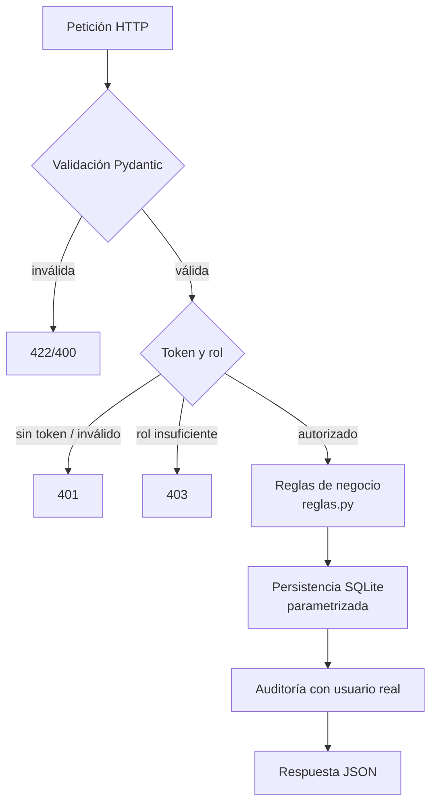

# 2.1.5.12 Estándares de codificación segura aplicados

> Prácticas de codificación segura aplicadas en el código de FactorUno,
> alineadas al **OWASP Top 10 (2021)** y a controles de validación,
> autenticación, manejo de errores y gestión de secretos.
> Fecha: octubre de 2026. Autores: grupo t420.

## 1. Estándares adoptados

| Estándar | Aplicación en el proyecto |
|---|---|
| OWASP Top 10 (2021) | Checklist principal (tabla §2) |
| OWASP ASVS (referencia) | Validación de entrada, sesión y control de acceso |
| PEP 8 + type hints | Estilo y anotaciones (`str \| None`, `dict[int, float]`) en todo `backend/app` |
| Conventional Commits | Historial de cambios auditable en Git |
| Principio de mínimo privilegio | Roles admin/analista/consulta; contenedores sin puertos innecesarios |

## 2. OWASP Top 10 → Implementación

| Riesgo | Aplicación en FactorUno | Dónde |
|---|---|---|
| A01 Control de acceso roto | Guards por rol en cada endpoint; `consulta` solo lectura | `app/main.py` (`Depends(auth.requiere_rol(...))`), `tests/test_auth.py` |
| A02 Fallas criptográficas | bcrypt para contraseñas; JWT HS256 firmado con secreto de entorno | `app/auth.py` |
| A03 Inyección | SQL parametrizado; whitelist de columnas en UPDATE; validación Pydantic | `app/servicio.py:101-107`, modelos en `app/main.py` |
| A04 Diseño inseguro | Análisis STRIDE documentado; reglas de negocio validadas en servidor | `docs/seguridad/01-amenazas-y-mitigacion.md`, `app/reglas.py` |
| A05 Mala configuración | Sin `*` en CORS; headers de seguridad en nginx; secretos por entorno | `app/main.py:_cors_origins`, `frontend/nginx.conf`, `.env.example` |
| A06 Componentes vulnerables | Dependencias fijadas con versión mínima; imágenes oficiales mínimas | `backend/requirements.txt`, Dockerfiles |
| A07 Fallas de autenticación | Hash + verificación; token con expiración; 401 uniforme | `app/auth.py:autenticar`, `test_auth.py` |
| A08 Integridad | Repositorio Git con commits convencionales; imágenes reproducibles | historial del repositorio |
| A09 Registro insuficiente | Auditoría de todas las mutaciones con usuario real | `app/db.py:audit`, `tests/test_servicio.py` |
| A10 SSRF | No se consumen URLs externas; alcance mínimo | — |

## 3. Prácticas aplicadas en el backend

1. **Validación en el borde**: cada modelo Pydantic restringe tipos y rangos (`ejercicio` 2000–2100, `tipo_sociedad` `^[AaCc]$`, `origen` `corredor|entidad`), de modo que la API rechaza entradas malformadas antes de tocar la lógica.
2. **Consultas parametrizadas**: nunca se concatenan valores del usuario en SQL; el único fragmento dinámico (nombres de columna en `UPDATE`) proviene de una whitelist fija del código.
3. **Reglas de negocio en el servidor**: el cálculo de factores, el redondeo a 8 decimales y la validación `suma 8..19 ≤ 1` viven en `reglas.py` y se ejecutan siempre, aunque el cliente las omita.
4. **Contraseñas**: hash con bcrypt (salt por usuario); comparación en tiempo constante vía librería; nunca se registran en logs ni se devuelven.
5. **Tokens**: JWT firmado (HS256) con `sub`, `rol`, `iat`, `exp`; secreto y horas de validez configurables por entorno.
6. **Errores controlados**: `HTTPException` con mensajes genéricos ("Credenciales invalidas", "Calificacion no encontrada"); no se exponen trazas al cliente.
7. **Auditoría**: cada mutación registra acción, registro, detalle, usuario autenticado y fecha.
8. **Secretos fuera del código**: `FACTORUNO_SECRET` y contraseñas iniciales se leen de variables de entorno; `.env.example` documenta las claves y `.env` está ignorado por Git. El despliegue escribe un secreto propio del servidor.

## 4. Prácticas aplicadas en el frontend

- **CSP estricta**: `default-src 'self'`, `script-src 'self'` (sin inline), `frame-ancestors 'none'` — mitiga XSS.
- **Headers de defensa**: `X-Content-Type-Options: nosniff`, `X-Frame-Options: DENY`, `Referrer-Policy: no-referrer`, `Permissions-Policy` sin cámara/micrófono/geolocalización.
- **Sesión**: el token se adjunta como `Authorization: Bearer` en cada petición; ante 401 se limpia la sesión y se vuelve al login.
- **El gate de UI por rol no es un control de seguridad**: es solo usabilidad; el servidor rechaza igualmente cualquier operación no autorizada.

## 5. Flujo seguro de una petición

## 6. Verificación y evidencia

| Control | Comando / evidencia |
|---|---|
| Suite completa | `cd backend && .venv/bin/python -m pytest tests/ -q` → **99 passed** |
| Cobertura | `--cov=app` → **94 %** (reglas 100 %, servicio 97 %, main 96 %, auth 92 %, db 90 %, aws_ext 82 %) |
| Casos de seguridad | 16 pruebas de autenticación/autorización (401/403/roles) |
| Integridad de carga | Carga CSV idempotente por llave de negocio probada (`test_carga_csv_inserta_y_es_idempotente_por_llave`) |
| Auditoría | Usuario real registrado en cada evento (`test_auditoria_registra_insert_update_delete`) |

## 7. Checklist de revisión de código (aplicada en cada cambio)

- [ ] ¿La entrada pasa por un modelo Pydantic o validación explícita?
- [ ] ¿El SQL usa parámetros y, si es dinámico, whitelist?
- [ ] ¿El endpoint declara el rol mínimo necesario?
- [ ] ¿La mutación deja evento de auditoría con el usuario real?
- [ ] ¿Los errores devuelven mensajes genéricos sin trazas?
- [ ] ¿Hay secretos nuevos? ¿Van por entorno y quedan fuera de Git?
- [ ] ¿La regla de negocio (factores ≤ 1, redondeo 8 decimales) se valida en servidor?
- [ ] ¿Se agregó o actualizó una prueba para el cambio?
